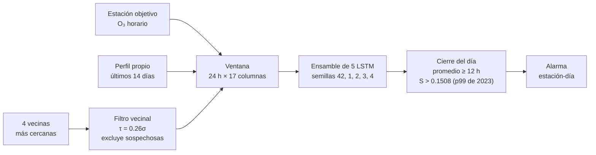
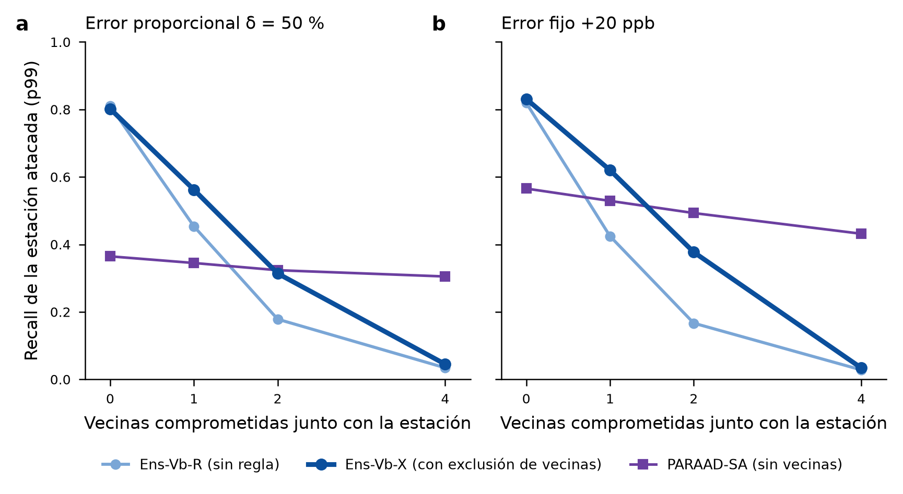
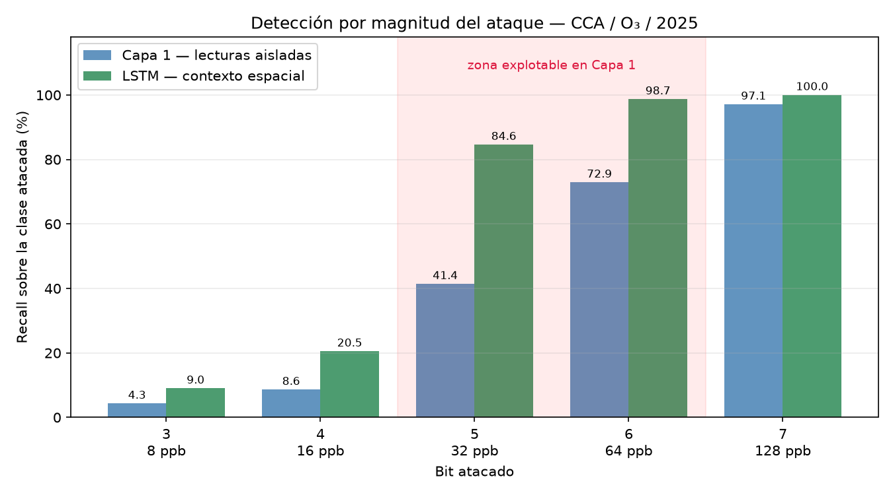

<div align="center">

# Detección de anomalías en redes de monitoreo atmosférico

**Aprendizaje profundo con contraste espacio-temporal, partiendo del ataque de
*bit flipping* en LoRaWAN 1.1, sobre mediciones reales de ozono de la RAMA**

[](requirements-lock.txt)
[](tests/)
[](docs/progreso.md)
[](docs/protocolo_anomalias_red_v1.md)
[](https://www.pcic.unam.mx/)

Trabajo de tesis de maestría · Posgrado en Ciencia e Ingeniería de la Computación, UNAM
<br>
José Emiliano Lili Beltrán · Asesor: Dr. José Jaime Camacho Escoto

</div>

---

## En pocas palabras

Una red de monitoreo atmosférico reporta ozono cada hora desde decenas de
estaciones. Cuando un sensor falla, se descalibra o su mensaje se altera en el
camino, el dato que llega al servidor suele tener formato válido y un valor
físicamente posible: un umbral fijo o una verificación de rango no lo ven.

Esta tesis responde, al cierre de cada día, **qué estación de la red reportó
datos anómalos**, usando la historia reciente de cada estación y la de sus
vecinas, con una tasa de falsas alarmas acotada.

El trabajo tiene dos etapas:

| Etapa | Pregunta | Estado |
|---|---|---|
| **1. *Bit flipping* en LoRaWAN 1.1** | ¿Qué posiciones de bit producen daño real (cambio de banda de calidad del aire) y cuáles detecta un LSTM? | Cerrada |
| **2. Anomalías a nivel de red** | ¿Se puede señalar la estación anómala usando la red completa, sin importar si la causa es falla, descalibración o ataque? | Experimentos cerrados; en redacción |

El resultado principal de la etapa 2 es **NERAD** (*Neighbour-filtered Ensemble
Recurrent Anomaly Detection*), el detector final de la tesis.

---

## NERAD, el detector final

Un ensamble de 5 redes LSTM que compara cada estación con su propio perfil de
14 días y con sus 4 vecinas más cercanas, y que descarta a las vecinas que se
desvían igual que la estación evaluada.



- **Entrenamiento supervisado** con anomalías sintéticas etiquetadas; la
  etiqueta nunca entra como dato.
- **Umbral p99** calibrado en 2023 sin ataques: se espera que 1 de cada 100
  días normales dé alarma.
- **Unidad de evaluación:** la estación-día, que es la pregunta del operador.

Código: [`src/detect/linea_base.py`](src/detect/linea_base.py),
[`src/detect/lstm_local.py`](src/detect/lstm_local.py) y
[`experiments/linea_base/rev24.py`](experiments/linea_base/rev24.py). Los 5
modelos del ensamble están versionados en
[`results/linea_base/rev22/modelos_definitivos/`](results/linea_base/rev22/modelos_definitivos/)
con sus huellas SHA-256; el filtro vecinal no requiere reentrenar.

---

## Resultados principales

### Banco de pruebas (2024 a julio de 2026)

Una estación atacada, 30 calendarios de ataque, 1 777 estación-días atacados y
23 005 limpios, los mismos para los dos detectores. Umbral p99 de 2023 limpio.
Modelos cargados de disco, sin reentrenar.

| Anomalía | Recall NERAD | Recall PARAAD-SA | F1 NERAD | F1 PARAAD-SA |
|---|---:|---:|---:|---:|
| ±100 % | **0.93** | 0.68 | **0.48** | 0.27 |
| ±50 % | **0.80** | 0.36 | **0.44** | 0.15 |
| ±20 % | **0.20** | 0.09 | **0.14** | 0.04 |
| ±40 ppb | **0.96** | 0.92 | **0.49** | 0.34 |
| ±20 ppb | **0.83** | 0.57 | **0.46** | 0.23 |
| ±10 ppb | **0.23** | 0.10 | **0.16** | 0.05 |

Días con falsa alarma al año por estación: **NERAD 4.7**, PARAAD-SA 9.6.

La precisión es baja para los dos detectores porque sólo el 0.77 % de las
estación-días está atacado: aun con 1 % de falsas alarmas, éstas son del mismo
orden que los ataques. Fuente:
[`results/linea_base/rev24/metricas_banco.csv`](results/linea_base/rev24/metricas_banco.csv).

### Comparación con el estado del arte y validación externa

- **PARAAD-SA en la RAMA** (reimplementado, entrenado sin etiquetas con
  2020–2022 y calibrado igual que los demás): el LSTM local supera su F1 en las
  36 combinaciones evaluadas.
- **Barcelona, 13 estaciones** (ajuste 2014–2016, calibración 2017, examen 2018
  y 2019): el LSTM local obtiene el mayor F1 con δ = 50 % y 20 % en los dos
  años. Véase [`docs/resultados_examen_barcelona_2018_2019.md`](docs/resultados_examen_barcelona_2018_2019.md).
- **Comparación justa con el V4** («peras con peras»): con etiquetas, el V4
  supervisado compartido sigue por debajo del LSTM local en 34 de 36
  combinaciones. Redacción en [`docs/redaccion_escalera_ablacion.md`](docs/redaccion_escalera_ablacion.md).

### Despliegue (agosto y septiembre de 2026)

Con NERAD y p99: recall de 0.99, 0.94 y 0.25 para anomalías de 100, 50 y 20 %,
con 1.1 días de falsa alarma al año por estación. **Es descriptivo, no un
examen limpio:** el filtro vecinal se diseñó después de que esa ventana se usó
para examinar el ensamble sin filtro.

### Dónde no funciona (pruebas de estrés)

<p align="center">
  
</p>

- **Vecindario comprometido.** Con δ = 50 %, el recall de la estación atacada
  es 0.80 sin vecinas alteradas, 0.56 con una, 0.31 con dos y 0.05 con todas.
  El filtro obliga al atacante a comprometer 3 o más estaciones. PARAAD-SA, que
  no usa vecinas, se mantiene entre 0.31 y 0.36.
- **Sesgo sostenido.** Con +20 ppb, NERAD detecta 0.76 de los días en las
  semanas 1–4 y sólo 0.11 en las semanas 5–8: su línea base absorbe el sesgo.
  Al terminar un sesgo largo quedan unas 7 semanas de alarmas de rebote.
- **Fusión con PARAAD-SA.** Cubre los dos puntos ciegos, pero con una sola
  estación atacada pierde F1 (−0.110) porque los umbrales de PARAAD-SA se
  trasladan mal entre años. Queda fuera del sistema y como trabajo futuro.

Detalle en [`docs/resultados_rev23_ataque_coordinado.md`](docs/resultados_rev23_ataque_coordinado.md),
[`docs/resultados_rev23b_ataque_lento.md`](docs/resultados_rev23b_ataque_lento.md),
[`docs/resultados_rev24_exclusion_vecinas.md`](docs/resultados_rev24_exclusion_vecinas.md)
y [`docs/resultados_rev25_fusion_paraad.md`](docs/resultados_rev25_fusion_paraad.md).

### Exploración con imágenes TINTO

Cada estación-día se convierte en una imagen de 32 × 32 píxeles y se entrena una
red convolucional. En una comparación pareada sobre los mismos días de 2025, el
modelo TINTO no supera a NERAD (recall 0.40 contra 0.90 con ×1.5; más falsas
alarmas y menos días cubiertos). Es una muestra pequeña con un solo calendario.
Véase [`docs/traspaso_tinto.md`](docs/traspaso_tinto.md).

---

## Etapa 1: *bit flipping* en LoRaWAN 1.1

En LoRaWAN el `FRMPayload` se cifra con **AES en modo contador**, un XOR contra
un flujo de clave: invertir un bit del texto cifrado invierte el mismo bit del
texto claro, sin conocer la clave. La integridad la protege el **MIC**, pero su
verificación termina en el Network Server; el tramo hacia el Application Server
queda sin integridad extremo a extremo. Es una vulnerabilidad de arquitectura
que afecta igual a 1.0.x y 1.1.

El daño se mide como **cambio de decisión**, no como tamaño del desplazamiento:

```
D = 1 [ f(x_real) ≠ f(x_recibido) ]
```

donde `f` asigna la banda de calidad del aire de la **NOM-172-SEMARNAT-2023**
(O₃: 58 / 90 / 135 / 175 ppb). Un salto de 32 ppb lejos de un corte no hace
daño; uno de 2 ppb junto al corte cambia la banda que se comunica a la población.

| Estación CCA, 2025 | Medición aislada | Con contexto espacial (LSTM) |
|---|---:|---:|
| Detección · desplazamiento de 32 ppb | 41.4 % | **84.6 %** |
| Detección · desplazamiento de 64 ppb | 72.9 % | **98.7 %** |
| Máximo daño no detectado | 27.1 % (64 ppb) | **9.1 % (16 ppb)** |

- **Existe un óptimo interior del atacante:** los cambios pequeños no cruzan
  umbrales y los grandes se detectan; el máximo daño no detectado está en medio.
- **Detector multianual V4:** 31 LSTM, uno por estación (ajuste 2020–2022,
  calibración 2023, prueba 2024–2026). El daño no detectado se concentra en los
  bits 3 a 5; el bit 5 se detecta en torno al 80 % y los bits 6 y 7 casi
  siempre. Protocolo en [`docs/protocolo_lstm_v4_multianual.md`](docs/protocolo_lstm_v4_multianual.md);
  resultados en [`results/lstm_v4_multianual_v1/`](results/lstm_v4_multianual_v1/).
- **Deriva estacional:** un perfil horario fijo subestima en 10.6 ppb la tarde
  de noviembre–diciembre; se adoptó un perfil causal de 14 días, que después se
  conservó en la etapa 2.
- **Contramedida probada sin éxito:** repartir el peso de los bits 4 y 5 en
  CayenneLPP aumentó los cambios de banda no detectados de 255 a 567 en 179 399
  intentos. Se documenta como resultado negativo en
  [`experiments/cayenne_mod/`](experiments/cayenne_mod/cierre_distribucion_pesos.md).

<p align="center">
  
</p>

---

## Cómo se evaluó

Las reglas completas están en
[`docs/protocolo_anomalias_red_v1.md`](docs/protocolo_anomalias_red_v1.md), con
sus revisiones fechadas en la sección 15.

- **Anomalía proporcional:** `x·(1+δ)` o `x/(1+δ)`, con el sentido sorteado por
  episodio; también escalón aditivo fijo de 10, 20 y 40 ppb. Episodios de 1 a
  7 días completos que empiezan a las 00 h, sólo en las 31 estaciones objetivo
  y sólo en horas con dato.
- **Calendarios pareados:** un mismo sorteo de estaciones, días y sentido se
  aplica a todas las magnitudes y a todos los detectores. Semillas derivadas
  de 42.
- **División temporal estricta:** ajuste 2020–2021 (y fondo de años previos),
  elección del diseño en 2022, umbral en 2023 sin ataques, banco 2024 a julio
  de 2026, despliegue agosto–septiembre de 2026. Los exámenes de uso único se
  abren una sola vez.
- **Registro previo:** cada experimento fija definiciones, métricas, regla de
  decisión y predicciones antes de ver resultados (`docs/registro_previo_*.md`).
  Lo decidido después de ver resultados se declara como tal.
- **Reproducibilidad:** `fijar_semilla(42)` antes de cada entrenamiento, dos
  corridas con salidas comparadas antes de aceptar un número, huellas SHA-256
  de modelos, planes y puntajes. Cada número dice si viene de un modelo recién
  entrenado o cargado de disco.
- **Comparaciones justas:** detectores del mismo tipo, mismo escenario, mismos
  calendarios y días; diferencias de F1 con intervalos *bootstrap* por bloques
  estación × mes.

---

## Limitaciones

- Las anomalías son sintéticas, inyectadas sobre datos reales; no hay anomalías
  reales etiquetadas.
- 2024 orientó varias revisiones del LSTM local: el examen limpio de ese
  detector es 2025–2026 (revisión 17). El despliegue de 2026 es descriptivo
  para NERAD.
- La ventaja de la base anclada en vecinas depende del periodo: no se sostuvo
  en el examen complementario de 2017–2019.
- Puntos ciegos declarados: vecindario completo comprometido y sesgo sostenido
  de más de unas 4 semanas.
- Las anomalías pequeñas (20 % o 10 ppb) siguen dentro de la variación natural
  del ozono para todos los detectores probados.
- PARAAD-SA es una reimplementación adaptada a la RAMA, no el código original.

---

## Estructura del repositorio

```
src/
  ingest/rama.py            Lectura de .xls SIMAT, formato largo, huecos
  decision/                 Bandas NOM-172 y métrica de daño (etapa 1)
  encoding/                 CayenneLPP y cifrado del FRMPayload, LoRaWAN 1.1
  attack/blind.py           Adversario ciego de bit flipping (etapa 1)
  detect/
    lstm.py                 LSTM V4 y fijar_semilla(42)
    multianual.py, ...      Protocolo V4 multianual (etapa 1)
    anomalias_red.py        Planes de ataque y matrices alteradas (etapa 2)
    estacion_dia.py         Unidad de evaluación estación-día
    vecinas.py              Regla de vecinas R3 (sin entrenamiento)
    lstm_local.py           LSTM local compartido L0
    linea_base.py           Bases vecinales y ensamble (Ens-Vb-R / NERAD)
    v4_supervisado.py       V4 supervisado (comparación justa)
    paraad.py               Reimplementación de PARAAD-SA
    evaluacion_red.py       Métricas, umbrales e intervalos

experiments/
  anomalias_red/            Revisiones 1–21 de la etapa 2
  linea_base/               LB1, LB2, revisiones 22–25 (NERAD y pruebas de estrés)
  barcelona/                Validación externa con PARAAD-SA
  exploracion_tinto/, tinto_raw/   Exploración con imágenes TINTO
  cayenne_mod/              Contramedida de codificación (etapa 1)

notebooks/                  01–16: de la inspección de datos al V4 multianual
docs/                       Protocolos, registros previos, resultados, bitácora
results/                    Métricas, umbrales, planes y modelos versionados
presentacion/               Presentación en Beamer (figuras en pgfplots/TikZ)
reporte_avances/            Reporte de avances para el comité tutor (LaTeX)
tests/                      Pruebas de ingesta, ataques, detectores y métricas
```

Documentos de entrada para orientarse:

| Documento | Qué contiene |
|---|---|
| [`docs/protocolo_anomalias_red_v1.md`](docs/protocolo_anomalias_red_v1.md) | Reglas de la etapa 2 y todas sus revisiones fechadas |
| [`docs/bitacora_decisiones.md`](docs/bitacora_decisiones.md) | Decisiones metodológicas y su fundamento |
| [`docs/progreso.md`](docs/progreso.md) | Registro fechado de cada sesión de trabajo |
| [`docs/referencias_literatura.md`](docs/referencias_literatura.md) | Literatura y comparadores verificados |
| [`docs/comparador_stc_raad.md`](docs/comparador_stc_raad.md) | Por qué STC-RAAD queda como comparación pendiente |

---

## Instalación

```bash
git clone https://github.com/JoseLili/lorawan11-rama-detection.git
cd lorawan11-rama-detection

python3.14 -m venv .venv && source .venv/bin/activate
pip install -r requirements-lock.txt

pytest -q
```

`requirements-lock.txt` fija las versiones exactas con que se obtuvieron los
resultados (TensorFlow 2.22 y Keras 3.16). `requirements.txt` sólo alcanza para
la etapa 1 sin redes neuronales.

### Datos

Los datos crudos **no están versionados**: se descargan y se colocan en
`data/raw/`.

- **RAMA/SIMAT, ozono horario.** Un zip por año (`20RAMA.zip` … `26RAMA.zip`),
  del portal de la Dirección de Monitoreo Atmosférico,
  [aire.cdmx.gob.mx](http://www.aire.cdmx.gob.mx/), sección *Bases de datos* →
  *RAMA*, formato Excel. Los años 2000–2019 sólo se usan como fondo de
  entrenamiento o exámenes complementarios.
- **Ventana de despliegue (agosto–septiembre de 2026):** datos crudos de
  SINAICA (INECC), porque el SIMAT no había publicado el zip; se comprobó la
  correspondencia contra el zip validado.
- **Barcelona (2014–2019):** descarga y auditoría en
  [`experiments/barcelona/`](experiments/barcelona/) y
  [`data/reference/barcelona_paraad/`](data/reference/barcelona_paraad/).
- **Sumas SHA-256** de cada archivo en `docs/checksums_*.txt`.
- **Catálogo de estaciones** (coordenadas): versionado en
  [`data/reference/cat_estacion_simat.csv`](data/reference/cat_estacion_simat.csv).

El [notebook 10](notebooks/10_inventario_multianual.ipynb) verifica formato,
centinela `-99`, cobertura y estaciones operativas, y genera el ozono preparado
en `data/processed/`. Se evalúan 31 estaciones: HGM sólo es contexto, XAL está
inactiva y COY, SJA y SFE quedan fuera por falta de datos.

### Uso mínimo (etapa 1)

```python
from src.encoding.cayenne import encode_o3, decode_o3, flip_bit
from src.decision.damage import daño

trama = encode_o3(87)            # 87 ppb → banda Aceptable
alterada = flip_bit(trama, 5)    # el adversario voltea el bit 5 (±32 ppb)

daño(87, decode_o3(alterada))    # 1 si el ataque cambió la banda reportada
```

---

## Referencias principales

- LoRa Alliance. *LoRaWAN™ 1.1 Specification*, 2017.
- J. Lee, D. Hwang, J. Park, K.-H. Kim. «Risk analysis and countermeasure for
  bit-flipping attack in LoRaWAN». *ICOIN*, 2017.
  [10.1109/ICOIN.2017.7899554](https://doi.org/10.1109/ICOIN.2017.7899554)
- M. Alizadeh, A. J. Bidgoly. «Bit flipping attack detection in low power wide
  area networks using a deep learning approach». *Peer-to-Peer Networking and
  Applications* 16, 2023.
  [10.1007/s12083-023-01511-y](https://doi.org/10.1007/s12083-023-01511-y)
- PARAAD-SA y STC-RAAD (Allka et al., 2024): comparadores de la etapa 2.
  Referencias completas en [`docs/referencias.bib`](docs/referencias.bib).
- SEMARNAT. *NOM-172-SEMARNAT-2023*. Diario Oficial de la Federación, 2024.

---

## Aviso

Trabajo de investigación académica. Los ataques y anomalías se generan en
simulación, sobre datos públicos y en un entorno controlado; no se ha
intervenido ninguna red en operación. El objetivo es defensivo: detectar
estaciones con datos alterados para que el operador las revise.
