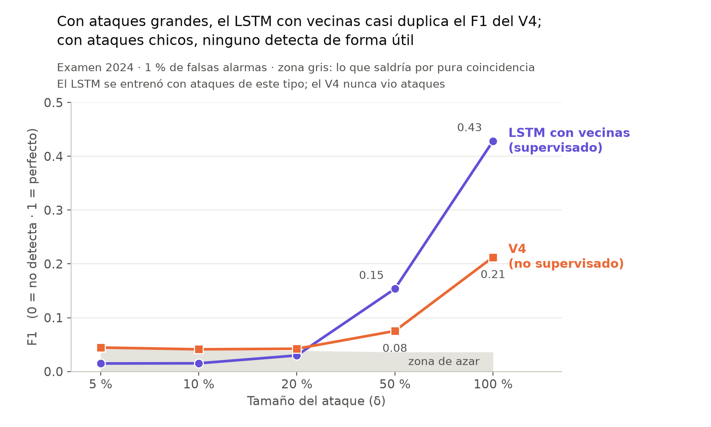

# Fichas de las gráficas

Una ficha por gráfica que se lleva al asesor (regla del 2026-10-19 en `CLAUDE.md`: 1 o 2
gráficas por semana, cada una explicada completa). Si una gráfica no se puede explicar con su
ficha, no se lleva.

---

## Recall por hora según δ (parte 2)

**Archivo:** `docs/img/anomalias_red_v1/recall_por_delta.png`, hecho con
`experiments/anomalias_red/graficar_recall_delta.py`. Sustituye para presentar a
`deteccion_por_delta.png`, que se conserva como historial.

### Qué pregunta responde

De las horas que alteramos en el examen de 2024, ¿qué fracción detecta cada detector, según el
tamaño de la alteración?

### Qué hay en cada eje

| | |
|---|---|
| **Eje X** | δ, cuánto se altera la lectura: con signo + se multiplica por (1 + δ) y con signo − se divide entre (1 + δ). Debajo, el **cambio típico en ppb**: la mediana, entre las horas alteradas, del mayor cambio entre estaciones en esa hora. |
| **Eje Y** | **Recall por hora (%)**, también llamado sensibilidad o tasa de verdaderos positivos. |

### De dónde sale cada número

- **Hora de red:** en cada hora de 2024, el detector da una sola respuesta para toda la red:
  ¿alguna estación tiene una anomalía?
- **Hora alterada:** una hora en la que, según el calendario, al menos una estación tiene su
  lectura cambiada. Cuenta sólo si el cambio sobrevive al redondeo a ppb enteros.
- **Umbral:** el puntaje que deja **5 % de las horas normales de 2023** con alerta. Por eso se
  dice «5 % de falsas alarmas por hora de red»: en un año normal, una alerta falsa cada ~20 horas.
- **Línea sólida (recall):** horas alteradas con alerta ÷ horas alteradas, sumando los 10
  calendarios del examen de 2024.
- **Línea punteada (azar):** esas mismas horas en 2024 **sin alterar**, con el mismo detector y el
  mismo umbral: qué fracción alerta de todos modos.
- **Barras:** el rango del recall entre los 10 calendarios, del peor al mejor.
- **Detectores en la gráfica:** el V4 se cargó de disco (es el modelo de la parte 1, sin
  reentrenar). El LSTM supervisado (revisión 7) está recién entrenado, uno por cada δ.
- **Datos:** `results/anomalias_red_v1/<detector>/d<δ>/por_tamano.csv` (tramos distintos de «sin
  cambio»).

### Qué tipo de medida es, y qué NO es

- **Es un recall con falsas alarmas fijas.** El umbral no se movió para ganar detección.
- **No es el F1,** ni la precisión, ni el daño. El F1 y la precisión dependen de cuántas anomalías
  metimos, y eso lo decidimos nosotros. Por eso el protocolo los deja sólo como contraste.

### Cómo leerla

- **Lo que importa es el hueco entre la línea sólida y su punteada:** lo que aporta la
  alteración.
  - Con δ = 100 %, el LSTM supervisado detecta 25.5 % de las horas alteradas. Esas mismas horas,
    sin alterar, alertan 4.5 %. La alteración aporta **21 puntos**.
  - El V4: 26.1 % frente a 8.9 %, **17 puntos**.
- **Con δ de 20 % o menos, cada sólida queda encima de su punteada:** el detector alerta lo mismo
  con y sin la alteración. No la ve.
- **Una línea sólida alta no basta.** El V4 marca ~10 % con δ = 5 %, pero su punteada marca lo
  mismo: es azar, no detección.

### Por qué las líneas punteadas no son planas ni iguales

- **El V4 alerta más que el LSTM en un año normal.** Los dos se calibraron al 5 % en 2023, pero en
  2024 limpio el V4 alerta 9.1 % de las horas y el LSTM, entre 0.5 y 6.6 %. Comparar el V4 contra
  el LSTM con las mismas falsas alarmas requiere la curva ROC, que sigue pendiente.
- **La punteada del V4 sube cuando δ baja** (de 8.9 a 11.3 %). Con δ chico, sólo cuentan como
  alteradas las horas con más ozono: con poco ozono, un 5 % no cambia ni un ppb al redondear. Y
  esas horas alertan más de por sí.
- **La punteada del LSTM cae a ~0.5 % con δ de 20 % o menos.** Se reentrena para cada δ, y con δ
  chico su umbral no se sostiene en 2024: casi no alerta.

### La tabla completa: los cuatro detectores y los dos niveles

Formato: recall / azar, en %. La gráfica muestra sólo las dos primeras filas del nivel de 5 %.

| Nivel 5 % | δ = 5 % | 10 % | 20 % | 50 % | 100 % |
|---|---|---|---|---|---|
| LSTM supervisado | 1.2 / 1.1 | 0.4 / 0.4 | 0.5 / 0.5 | 11.8 / 5.4 | 25.5 / 4.5 |
| V4 | 11.4 / 11.3 | 10.3 / 10.1 | 10.3 / 9.6 | 14.2 / 8.9 | 26.1 / 8.9 |
| Random Forest | 7.4 / 7.3 | 6.4 / 6.5 | 7.3 / 7.1 | 8.0 / 5.6 | 16.4 / 5.1 |
| IsolationForest | 8.2 / 8.2 | 7.5 / 7.5 | 7.2 / 7.2 | 6.7 / 6.6 | 6.7 / 6.6 |

| Nivel 1 % | δ = 5 % | 10 % | 20 % | 50 % | 100 % |
|---|---|---|---|---|---|
| LSTM supervisado | 0.1 / 0.1 | 0.0 / 0.0 | 0.1 / 0.1 | 3.3 / 1.0 | 9.5 / 0.9 |
| V4 | 2.6 / 2.6 | 2.4 / 2.4 | 2.5 / 2.2 | 4.4 / 2.1 | 13.8 / 2.1 |
| Random Forest | 1.7 / 1.7 | 1.4 / 1.4 | 1.7 / 1.6 | 1.9 / 1.3 | 9.2 / 1.7 |
| IsolationForest | 2.6 / 2.6 | 2.3 / 2.3 | 2.2 / 2.2 | 2.0 / 2.0 | 2.0 / 2.0 |

### Preguntas que puede hacer el asesor

- **¿Por qué el recall es tan bajo aun con el doble?** Con δ = 100 %, el 41 % de las horas
  alteradas cambia menos de 16 ppb (5,814 de 14,044). El 88 % de esas horas cae entre las 19 y las
  08 h, cuando el doble de 8 ppb son 16 ppb. Ese cambio cae dentro de la variación normal.
- **¿Por qué no el F1?** Porque depende de cuántas anomalías hay en el examen, y eso lo fijamos
  nosotros. El recall con falsas alarmas fijas no depende de eso.
- **¿Y por episodio?** No está en esta gráfica. Las tablas por episodio están en `progreso.md`
  (2026-10-16 y 2026-10-18).

### En una frase

Con δ = 50 % y 100 % los dos detectores ven la alteración. Con δ = 20 % o menos, que incluye la
descalibración realista de 5–10 %, alertan lo mismo que si no hubiera alteración.

---

## F1 según δ: LSTM supervisado con vecinas contra V4 (parte 2, 2026-10-23)

**Archivo:** `docs/img/anomalias_red_v1/f1_por_delta.png`, hecho con
`experiments/anomalias_red/graficar_f1_delta.py`. Es la gráfica de la semana. Usa la métrica
principal de la revisión 9 del protocolo.

### Qué pregunta responde

En el mismo examen, ¿cuánto mejor detecta el LSTM supervisado con vecinas que el V4 no
supervisado, según el tamaño del ataque?

### Qué hay en cada eje

| | |
|---|---|
| **Eje X** | **El tamaño del ataque (δ), igual para los dos detectores.** Las lecturas de la estación atacada se multiplican por (1 + δ) o se dividen entre (1 + δ) durante días completos. Con δ = 100 % la lectura se duplica o queda a la mitad; con δ = 5 % cambia un 5 %. |
| **Eje Y** | **F1**, el de siempre: 0 = no detecta nada, 1 = detecta todo sin falsas alarmas. |

### Qué es un «caso» en este F1

Cada hora de 2024 es un caso. En cada hora, el detector dice **alarma o no alarma** para toda la
red, y se compara con la realidad: **¿había alguna estación atacada en esa hora?**

| | Había ataque | No había ataque |
|---|---|---|
| **Sonó la alarma** | acierto (TP) | falsa alarma (FP) |
| **No sonó** | ataque que se escapó (FN) | bien (TN) |

- precisión = TP / (TP + FP): de las alarmas, cuántas eran de verdad;
- recall = TP / (TP + FN): de las horas atacadas, cuántas dieron alarma;
- **F1 = 2 · precisión · recall / (precisión + recall).**

No es una métrica compuesta ni inventada: es el F1 estándar, contando horas.

### De dónde sale cada número

- **El examen:** los 10 calendarios de 2024, con 192 ataques. Los dos detectores reciben
  **exactamente los mismos datos alterados**, y se juntan los 10 calendarios.
- **El umbral de alarma:** el que hace sonar la alarma en **1 de cada 100 horas** de 2023 sin
  ataques. Se fijó antes del examen y no se movió.
- **La zona gris («zona de azar»):**
  - es el F1 que sacaría el detector **en esas mismas horas de 2024 sin ataque**, con el mismo
    umbral;
  - mide cuánto «acierta» sólo porque a veces su alarma coincide con una hora atacada;
  - se dibuja el mayor de los dos detectores.
  - **Sólo lo que queda arriba de la zona gris es detección.**
- **Los detectores:**
  - **LSTM con vecinas (revisión 8):** aprendió con ataques sintéticos del mismo tipo; un modelo
    por δ, el oficial del protocolo, recién entrenado en Colab.
  - **V4:** el modelo de la parte 1, cargado de disco. Nunca vio ataques: predice el ozono y alerta
    cuando la lectura no se parece a lo predicho.
- **Datos:** `results/anomalias_red_v1/<detector>/d<δ>/puntajes.csv.gz` y `metricas.csv` (el
  umbral), más las matrices del examen. Coincide con
  `results/anomalias_red_v1/analisis_revision8/metricas_estandar.csv`.

### Qué NO es

- **No es el F2 por lectura de la parte 1.** Esa parte mide otro ataque (bit flipping, una sola
  lectura) con otra unidad. Por eso los bits no van en esta gráfica.
- **No se compara con el F1 de otros artículos.** Depende del problema, de cuántas horas atacadas
  hay (12 a 16 %) y de cómo se fija el umbral.

### Cómo leerla

- **Con δ = 100 %:** el LSTM con vecinas saca **0.43** y el V4, **0.21**. Por coincidencia sacarían
  0.03 y 0.04. El supervisado con vecinas casi duplica el F1 del no supervisado. Ojo: lo que se
  duplica es el F1, no el número de ataques encontrados.
- **Con δ = 50 %:** **0.15** contra **0.08**.
- **Con δ = 20 % o menos,** las dos líneas quedan sobre la zona gris: ninguno detecta de forma
  útil. Lo más que hay es el LSTM con δ = 20 %, 0.03 contra 0.015 por coincidencia.
- **¿Por qué el V4 queda arriba del LSTM con δ = 5 y 10 %?** No detecta más: suena más seguido en
  general (con 1 %, en el 2.3 % de las horas de 2024 limpio, contra 1.9 % del LSTM de δ = 100 % y
  menos los de δ chico), así que coincide más con horas atacadas. Su F1 sin ataque es igual de
  alto.
- **No depende de un calendario con suerte:** con δ = 50 % y 100 %, el peor de los 10 calendarios
  del LSTM (0.12 y 0.32) supera al mejor del V4 (0.11 y 0.28). La gráfica no dibuja ese rango, para
  no cargarla.

### La tabla completa

F1, con el valor sin ataque entre paréntesis:

| Nivel 1 % | δ = 5 % | 10 % | 20 % | 50 % | 100 % |
|---|---|---|---|---|---|
| LSTM con vecinas | 0.01 (0.01) | 0.02 (0.02) | 0.03 (0.01) | 0.15 (0.03) | 0.43 (0.03) |
| V4 | 0.04 (0.04) | 0.04 (0.04) | 0.04 (0.04) | 0.08 (0.04) | 0.21 (0.04) |

| Nivel 5 % | δ = 5 % | 10 % | 20 % | 50 % | 100 % |
|---|---|---|---|---|---|
| LSTM con vecinas | 0.05 (0.05) | 0.08 (0.07) | 0.12 (0.08) | 0.31 (0.11) | 0.48 (0.10) |
| V4 | 0.13 (0.13) | 0.12 (0.12) | 0.13 (0.12) | 0.17 (0.11) | 0.29 (0.11) |

Precisión y recall con 1 %:

| | δ = 20 % | δ = 50 % | δ = 100 % |
|---|---|---|---|
| LSTM con vecinas | 0.25 / 0.02 | 0.46 / 0.09 | 0.62 / 0.33 |
| V4 | 0.15 / 0.02 | 0.25 / 0.04 | 0.46 / 0.14 |

### Preguntas que puede hacer el asesor

- **¿El supervisado hace trampa porque sabe qué δ viene?** No. Un solo modelo, el entrenado con
  δ = 100 %, examinado con todos los δ, saca 0.43, 0.21 y 0.05 con δ = 100, 50 y 20 %: igual o
  mejor que el oficial (`progreso.md`, generalización, 2026-10-23).
- **¿Por qué 0.43 si en artículos de IDS se ve 0.98?** Allí se clasifica tráfico de red, con otra
  proporción de ataques y muchas veces con el umbral elegido en el mismo examen. Aquí el ataque es
  una lectura de ozono que se parece a un día normal, y el umbral se fijó antes, con 2023.
- **¿Por qué el V4 si era para bit flipping?** Porque es el detector de la parte 1, sin reentrenar.
  Aquí presenta el mismo examen que el LSTM.
- **¿Y la regla de vecinas, que no aprende?** Saca 0.32, 0.15 y 0.07 con δ = 100, 50 y 20 %.
  Comparar con las vecinas, aun sin entrenar, ya supera al V4. El aprendizaje supervisado suma
  encima (`progreso.md`, comparación general).
- **¿Por qué con 1 % y no con 5 %?** Es el umbral de operación de la revisión 9: con 5 %, la red
  daría unas 700 horas de falsa alarma al año. La tabla de arriba trae también el 5 %.
- **¿De dónde salen las falsas alarmas?** Sobre todo de los 14 días después de cada ataque, cuando
  la referencia de 14 días está contaminada, y de un mayo de 2024 con ozono excepcional
  (`progreso.md`, estudio de las falsas alarmas).

### En una frase

En el mismo examen, el LSTM supervisado con vecinas casi duplica el F1 del V4 con δ = 50 % y
100 %; con δ de 20 % o menos, ninguno de los dos detecta de forma útil. El LSTM aprendió con
ataques de este mismo tipo y el V4 nunca vio un ataque, así que la ventaja está demostrada para
este tipo de ataque, no para cualquiera.
