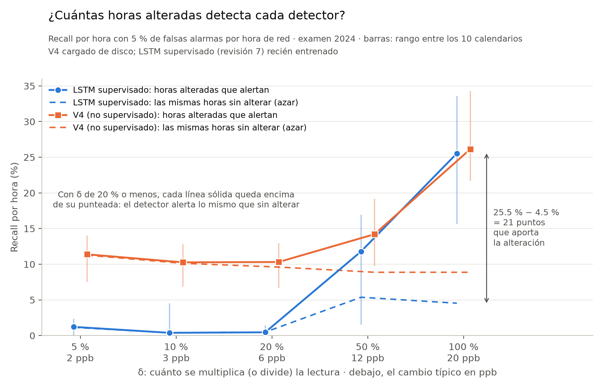

# Fichas de las gráficas

Una ficha por gráfica que se lleva al asesor (regla del 2026-10-19 en `CLAUDE.md`: 1 o 2
gráficas por semana, cada una explicada completa). Si una gráfica no se puede explicar con su
ficha, no se lleva.

---

## Recall por hora según δ (parte 2)

**Archivo:** `docs/img/anomalias_red_v1/recall_por_delta.png`, hecho con
`experiments/anomalias_red/graficar_recall_delta.py`. Sustituye para presentar a
`deteccion_por_delta.png`, que se conserva como historial.

### Qué pregunta responde

De las horas que alteramos en el examen de 2024, ¿qué fracción detecta cada detector, según el
tamaño de la alteración?

### Qué hay en cada eje

| | |
|---|---|
| **Eje X** | δ, cuánto se altera la lectura: con signo + se multiplica por (1 + δ) y con signo − se divide entre (1 + δ). Debajo, el **cambio típico en ppb**: la mediana, entre las horas alteradas, del mayor cambio entre estaciones en esa hora. |
| **Eje Y** | **Recall por hora (%)**, también llamado sensibilidad o tasa de verdaderos positivos. |

### De dónde sale cada número

- **Hora de red:** en cada hora de 2024, el detector da una sola respuesta para toda la red:
  ¿alguna estación tiene una anomalía?
- **Hora alterada:** una hora en la que, según el calendario, al menos una estación tiene su
  lectura cambiada. Cuenta sólo si el cambio sobrevive al redondeo a ppb enteros.
- **Umbral:** el puntaje que deja **5 % de las horas normales de 2023** con alerta. Por eso se
  dice «5 % de falsas alarmas por hora de red»: en un año normal, una alerta falsa cada ~20 horas.
- **Línea sólida (recall):** horas alteradas con alerta ÷ horas alteradas, sumando los 10
  calendarios del examen de 2024.
- **Línea punteada (azar):** esas mismas horas en 2024 **sin alterar**, con el mismo detector y el
  mismo umbral: qué fracción alerta de todos modos.
- **Barras:** el rango del recall entre los 10 calendarios, del peor al mejor.
- **Detectores en la gráfica:** el V4 se cargó de disco (es el modelo de la parte 1, sin
  reentrenar). El LSTM supervisado (revisión 7) está recién entrenado, uno por cada δ.
- **Datos:** `results/anomalias_red_v1/<detector>/d<δ>/por_tamano.csv` (tramos distintos de «sin
  cambio»).

### Qué tipo de medida es, y qué NO es

- **Es un recall con falsas alarmas fijas.** El umbral no se movió para ganar detección.
- **No es el F1,** ni la precisión, ni el daño. El F1 y la precisión dependen de cuántas anomalías
  metimos, y eso lo decidimos nosotros. Por eso el protocolo los deja sólo como contraste.

### Cómo leerla

- **Lo que importa es el hueco entre la línea sólida y su punteada:** lo que aporta la
  alteración.
  - Con δ = 100 %, el LSTM supervisado detecta 25.5 % de las horas alteradas. Esas mismas horas,
    sin alterar, alertan 4.5 %. La alteración aporta **21 puntos**.
  - El V4: 26.1 % frente a 8.9 %, **17 puntos**.
- **Con δ de 20 % o menos, cada sólida queda encima de su punteada:** el detector alerta lo mismo
  con y sin la alteración. No la ve.
- **Una línea sólida alta no basta.** El V4 marca ~10 % con δ = 5 %, pero su punteada marca lo
  mismo: es azar, no detección.

### Por qué las líneas punteadas no son planas ni iguales

- **El V4 alerta más que el LSTM en un año normal.** Los dos se calibraron al 5 % en 2023, pero en
  2024 limpio el V4 alerta 9.1 % de las horas y el LSTM, entre 0.5 y 6.6 %. Comparar el V4 contra
  el LSTM con las mismas falsas alarmas requiere la curva ROC, que sigue pendiente.
- **La punteada del V4 sube cuando δ baja** (de 8.9 a 11.3 %). Con δ chico, sólo cuentan como
  alteradas las horas con más ozono: con poco ozono, un 5 % no cambia ni un ppb al redondear. Y
  esas horas alertan más de por sí.
- **La punteada del LSTM cae a ~0.5 % con δ de 20 % o menos.** Se reentrena para cada δ, y con δ
  chico su umbral no se sostiene en 2024: casi no alerta.

### La tabla completa: los cuatro detectores y los dos niveles

Formato: recall / azar, en %. La gráfica muestra sólo las dos primeras filas del nivel de 5 %.

| Nivel 5 % | δ = 5 % | 10 % | 20 % | 50 % | 100 % |
|---|---|---|---|---|---|
| LSTM supervisado | 1.2 / 1.1 | 0.4 / 0.4 | 0.5 / 0.5 | 11.8 / 5.4 | 25.5 / 4.5 |
| V4 | 11.4 / 11.3 | 10.3 / 10.1 | 10.3 / 9.6 | 14.2 / 8.9 | 26.1 / 8.9 |
| Random Forest | 7.4 / 7.3 | 6.4 / 6.5 | 7.3 / 7.1 | 8.0 / 5.6 | 16.4 / 5.1 |
| IsolationForest | 8.2 / 8.2 | 7.5 / 7.5 | 7.2 / 7.2 | 6.7 / 6.6 | 6.7 / 6.6 |

| Nivel 1 % | δ = 5 % | 10 % | 20 % | 50 % | 100 % |
|---|---|---|---|---|---|
| LSTM supervisado | 0.1 / 0.1 | 0.0 / 0.0 | 0.1 / 0.1 | 3.3 / 1.0 | 9.5 / 0.9 |
| V4 | 2.6 / 2.6 | 2.4 / 2.4 | 2.5 / 2.2 | 4.4 / 2.1 | 13.8 / 2.1 |
| Random Forest | 1.7 / 1.7 | 1.4 / 1.4 | 1.7 / 1.6 | 1.9 / 1.3 | 9.2 / 1.7 |
| IsolationForest | 2.6 / 2.6 | 2.3 / 2.3 | 2.2 / 2.2 | 2.0 / 2.0 | 2.0 / 2.0 |

### Preguntas que puede hacer el asesor

- **¿Por qué el recall es tan bajo aun con el doble?** Con δ = 100 %, el 41 % de las horas
  alteradas cambia menos de 16 ppb (5,814 de 14,044). El 88 % de esas horas cae entre las 19 y las
  08 h, cuando el doble de 8 ppb son 16 ppb. Ese cambio cae dentro de la variación normal.
- **¿Por qué no el F1?** Porque depende de cuántas anomalías hay en el examen, y eso lo fijamos
  nosotros. El recall con falsas alarmas fijas no depende de eso.
- **¿Y por episodio?** No está en esta gráfica. Las tablas por episodio están en `progreso.md`
  (2026-10-16 y 2026-10-18).

### En una frase

Con δ = 50 % y 100 % los dos detectores ven la alteración. Con δ = 20 % o menos, que incluye la
descalibración realista de 5–10 %, alertan lo mismo que si no hubiera alteración.
