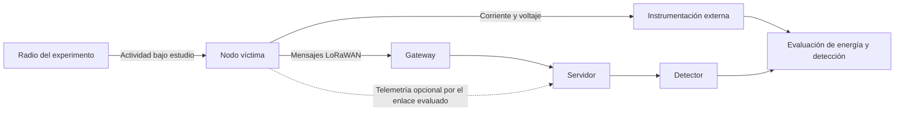

# Propuesta de estudio: consumo anómalo y detección en LoRaWAN

> **Nota 2026-10-12:** propuesta **no adoptada** en la junta de ese día. El asesor optó por la detección de sensores anómalos a nivel de red; ver [progreso, 2026-10-12](progreso.md#2026-10-12--junta-con-el-asesor-anomalías-a-nivel-de-red). Se conserva como historial. El protocolo vigente de la parte 2 es [`protocolo_anomalias_red_v1.md`](protocolo_anomalias_red_v1.md).

**Documento para analizar con el Dr. José Jaime Camacho Escoto.**
Preparado el 11 de octubre de 2026.

Estado: propuesta de investigación y piloto, pendiente de discusión. No hay
resultados experimentales del ataque descrito en este documento. La
participación de UCLM y la disponibilidad de sus recursos no están acordadas.

Para una lectura breve: secciones 1, 7, 11 y 14. Para comparar este estudio con
la alternativa de integridad, consultar las
[propuestas para la reunión](propuestas_reunion_2026-10-12.md).

## 1. Propuesta en una página

**Título provisional:** Información y costo energético para detectar ataques
de consumo en LoRaWAN.

**Pregunta central:** ¿Cómo cambia la energía adicional acumulada antes de una
alerta cuando el defensor incorpora información del nodo a los registros del
servidor, y cuánto cuesta obtener y transmitir esa información?

El estudio propone medir un ataque de consumo sobre un nodo real. El primer
candidato es la prolongación de recepción en Clase A. Se comparará lo que puede
observar el servidor con sus registros habituales y lo que puede observar al
recibir telemetría adicional del nodo. La evaluación incluirá actividad
legítima, falsas alarmas, tiempo hasta alerta y consumo adicional.

La referencia de energía se obtendrá con instrumentación externa. El detector
usará únicamente información disponible en el escenario de despliegue definido.

| Elemento | Compromiso de alcance propuesto |
|---|---|
| Ataques nuevos | Un mecanismo, cuya viabilidad se comprueba primero |
| Banco inicial | Un nodo víctima, un equipo de radio para el experimento, un gateway y un servidor |
| Comparación principal | Registros habituales frente a telemetría adicional |
| Detectores | Una regla simple; un segundo detector solo si existe una pregunta adicional clara |
| Daño principal | Energía adicional medida por evento y durante un horizonte de observación |
| Resultado de detección | Tiempo y energía acumulada hasta alertar; casos sin alerta |
| Costo de defensa | Energía, bytes y tiempo en el aire de la telemetría |
| Primera decisión | Piloto de dos semanas; continuidad resuelta como máximo en la cuarta |
| Producto de tesis | Segundo caso de caracterización de consecuencias y límites de detección |
| Producto candidato para artículo | Evaluación experimental del compromiso entre información, detección y costo |

**Recomendación:** defender ante el tutor la realización del piloto y los
criterios de continuidad. El compromiso con una campaña completa se tomará
cuando haya evidencia de viabilidad y una diferencia clara frente a la literatura.

## 2. Relación con la primera parte de la tesis

La primera parte estudia alteraciones de mensajes y sus consecuencias sobre
decisiones ambientales. La segunda estudiaría consecuencias energéticas.
Comparten una forma de evaluar: definir adversario, observaciones disponibles,
referencia normal, consecuencia, detector y carga de falsas alarmas.

| Aspecto | Bit flipping ya estudiado | Consumo por estudiar |
|---|---|---|
| Consecuencia | Cambio de decisión sobre ozono | Energía adicional consumida |
| Evidencia del defensor | Lectura y contexto temporal/espacial | Registros de comunicación y posible telemetría |
| Variación del ataque | Posición y patrón de alteración | Frecuencia y duración del efecto, según el mecanismo reproducible |
| Resultado | Consecuencias que pasan sin alerta | Consecuencias acumuladas antes de alertar o sin alerta |
| Referencia | Datos originales y decisión correspondiente | Consumo normal bajo condiciones comparables |
| Falsas alarmas | Lecturas legítimas señaladas | Operación legítima señalada |

Los modelos de amenaza pueden ser diferentes: acceso al backend en la primera
parte y acceso por radio en la segunda. Esa diferencia se declara, no se oculta
mediante una puntuación común.

Los cambios de decisión y los joules conservan sus unidades. Dos aplicaciones
de un protocolo no demuestran que este sirva para cualquier ataque. El artículo
conjunto puede centrarse en el segundo caso sin incluir toda la tesis.

## 3. Mecanismo candidato y razón para estudiarlo

Después de transmitir, un dispositivo Clase A dispone de ventanas de recepción.
La recepción de un paquete puede mantener activo el radio hasta que se reciba
y se compruebe su validez, según el comportamiento de la implementación.
El paquete puede terminar descartado después de haber consumido energía.

Mikhaylov y coautores demostraron un ataque de este tipo con mensajes no
confirmados y ADR desactivado. Sus mediciones de incremento de consumo
corresponden a eventos de comunicación; no describen directamente la pérdida
de autonomía de cualquier nodo. El experimento de referencia tampoco es un
ataque de supresión de ACK. [Artículo, secciones 4–5](https://cc.oulu.fi/~kmikhayl/site-assets/pdfs/2019_conf_ARES19_preprint.pdf).

La hipótesis experimental inicial es que el mecanismo pueda reproducirse en
alguna configuración pertinente del hardware disponible. No se presupone su
éxito: pueden intervenir filtros del radio, temporizadores y decisiones del
firmware que cambien o limiten el efecto.

El interés para detección es que el uplink legítimo podría seguir llegando al
servidor mientras aumenta el consumo local. Esta posibilidad debe comprobarse
en las trazas; no se da por demostrada para el banco propuesto.

## 4. Qué se conoce, qué se propone y qué falta demostrar

| Afirmación | Estado |
|---|---|
| Existen ataques sobre el consumo de recepción | Antecedente experimental publicado |
| Observar paquetes inválidos puede ayudar | Idea ya señalada en el antecedente; no sería novedad por sí sola |
| El ataque funciona en nuestros nodos y firmware | Pendiente del piloto |
| Los registros habituales contienen evidencia suficiente | Pendiente de inspección y evaluación |
| La telemetría adicional mejora la detección | Hipótesis por contrastar |
| Su costo es aceptable para una aplicación concreta | Resultado por medir; depende del presupuesto de consumo |
| La evaluación conjunta constituye un aporte publicable | Pendiente de contraste bibliográfico y resultados |

La contribución candidata es cuantificar cómo cambia el daño energético
observado al modificar la información disponible, manteniendo controladas las
falsas alarmas y midiendo el costo de esa información.

La revisión de novedad debe examinar si los trabajos previos ya comparan estos
elementos bajo tráfico legítimo, ataques intermitentes y mediciones reales.
La revisión de ataques de energía de IEEE Sensors Journal es una referencia
prioritaria. En la búsqueda previa se consultó su resumen; falta revisar el
texto completo y su evaluación antes de afirmar una brecha.
[Referencia](https://doi.org/10.1109/JSEN.2024.3504259).

Repetir el ataque con otra placa, reportar un aumento de consumo o aplicar un
clasificador a etiquetas fáciles no bastan por sí solos como argumento de novedad.

## 5. Modelo de amenaza y límites del defensor

El escenario inicial supone un atacante externo por radio, sin las claves del
nodo y sin control del firmware ni del servidor. El alcance de radio, duración,
recursos y conocimiento de la configuración se documentarán en el protocolo.
El experimento se realizará en el entorno controlado previsto por el laboratorio.

El nodo y el servidor se consideran confiables para este segundo caso. Si se
transmite telemetría para la defensa, debe documentarse cómo se protege y qué
sucede si llega tarde o se pierde. No se supone un canal adicional perfecto.

Se mantendrán separados tres conjuntos de datos:

1. **Referencia experimental:** corriente, voltaje y registro del experimento.
   Permite estimar energía y conocer cuándo estuvo presente el ataque.
2. **Información operativa del defensor:** campos que el nodo o el servidor
   realmente pueden observar y entregar dentro del plazo previsto.
3. **Etiquetas de evaluación:** inicio y fin del ataque, configuración de la
   campaña y condición normal/atacada. No se entregan al detector al decidir.

Si una perturbación benigna produce las mismas observaciones que el ataque,
el detector podrá señalar consumo anómalo, pero no atribuir intención a partir
de esas variables. Ese límite debe formar parte del resultado.

## 6. Banco de pruebas y observaciones

| Recurso | Papel previsto | Verificación pendiente |
|---|---|---|
| Gateway Heltec HT-M02 | Transporte de mensajes hacia el servidor | Banda, configuración y registros exportables |
| CubeCell HTCC-AB01 | Candidato a nodo víctima | Versión de pila y acceso a eventos del radio |
| Wireless Tracker | Candidato para el equipo de radio experimental, o nodo alternativo | Control de radio y compatibilidad necesarios |
| Raspberry Pi 4 | Servidor y registro de eventos | Instalación y sincronización de registros |
| Instrumento de corriente/voltaje | Referencia energética externa | Disponibilidad, resolución temporal, rango y calibración |

La asignación de los dos nodos es provisional. Se documentarán versiones de
placa, radio, firmware y protocolo. El repositorio oficial de CubeCell describe
una pila basada en LoRaWAN 1.0.2: no se llamará validación de LoRaWAN 1.1 a un
experimento que ejecute otra versión. [Heltec](https://github.com/HelTecAutomation/CubeCell-Arduino).

Para energía se fijará una frontera de medición: placa completa o radio, según
lo que permita el montaje. LEDs, GPS, depuración y otros periféricos pueden
afectar el consumo; su configuración debe permanecer documentada. No se
atribuirá al radio toda la energía de una placa sin separar sus componentes.

La Raspberry Pi sirve para registrar datos y alojar servicios; no sustituye
al instrumento que mide el consumo del nodo.

Los datos del instrumento van a la evaluación, no automáticamente al detector.
La flecha de telemetría representa información lógica, no una radio adicional.

## 7. Piloto y criterios de continuidad

| Periodo | Trabajo | Evidencia esperada |
|---|---|---|
| Primera semana | Inventario, enlace básico, inspección de registros y medición normal | Configuración reproducible y traza normal |
| Segunda semana | Intento de reproducción controlada y repeticiones | Traza bajo ataque, o explicación documentada de por qué no se reproduce |
| Semanas 3–4, si hacen falta | Resolver dependencias concretas, inspeccionar señales y contrastar antecedentes | Decisión de continuidad y protocolo de campañas |

Al cierre del piloto se requieren cuatro respuestas:

- **Efecto:** ¿hay una diferencia energética repetible y distinguible de la
  incertidumbre de medición y de la variación normal?
- **Observación:** ¿qué señales ve el servidor, cuáles solo el nodo y qué
  cambios hacen falta para exponerlas?
- **Viabilidad:** ¿hay instrumento, acceso al firmware y tiempo para las campañas?
- **Aporte:** ¿qué comparación específica añadiría conocimiento frente a los
  antecedentes más cercanos?

Se continúa si las cuatro respuestas son suficientes para cerrar un protocolo.
Si falla una y no existe una solución concreta dentro del primer mes, se
reconsidera el alcance con el tutor. No se encadena una búsqueda indefinida de
ataques hasta encontrar uno que produzca una gráfica favorable.

Un piloto negativo puede documentarse, pero no se da por equivalente al estudio
completo ni por garantía de publicación. La alternativa de integridad conserva
también la dependencia de instrumentación si se promete energía medida.

## 8. Comparación experimental después del piloto

Se definen dos vistas de información:

- **V0:** registros habituales que realmente entregue la plataforma.
- **V1:** V0 más un conjunto pequeño de variables del nodo. Candidatas:
  tiempo de recepción acumulado, conteos de recepciones rechazadas o estados del
  radio. Su disponibilidad y costo quedan pendientes del piloto.

Las variables no se consideran equivalentes: una recepción inválida puede
tener distintas causas; un cambio de RSSI de los uplinks no demuestra que el
nodo haya recibido paquetes del atacante.

La primera comparación debe mantener el procedimiento de detección tan
equivalente como sea posible para aislar el efecto de la información. Si V0 no
contiene una señal observable pertinente, se reporta esa limitación; no se
inventan entradas ni se promete que un modelo la resuelva.

Un umbral sobre una estadística interpretable constituye la referencia. Un
segundo método podría acumular desviaciones a lo largo de varios eventos,
mediante un detector secuencial. La fórmula y calibración se fijarán después del
piloto. Una implementación del equipo UCLM puede ocupar ese segundo lugar si
encaja con los observables y existe una tarea científica concreta.

La campaña mínima incluirá:

| Condición | Propósito |
|---|---|
| Operación normal con configuración estable | Estimar referencia de consumo y falsas alarmas |
| Recepción legítima y variación benigna pertinente | Evaluar confusiones con actividad permitida |
| Ataque frecuente | Verificar el efecto y la señal en un caso claro |
| Ataque intermitente | Examinar daño acumulado y retraso de alerta |
| Normalidad con telemetría activada | Medir el costo de observación |
| Ataque con telemetría activada | Medir detección y consumo bajo esa defensa |

Las intensidades, duraciones, repeticiones y configuración de radio se fijarán
con lo aprendido en el piloto. No se cubrirán todas las combinaciones posibles.
Al variar la frecuencia de reporte de telemetría, se tendrá en cuenta que
mensajes adicionales también pueden crear oportunidades adicionales de recepción.

## 9. Métricas y cómo interpretarlas

**Energía por periodo.** Se obtiene de la corriente y el voltaje:

\[
E[a,b] = \int_a^b V(t)I(t)\,dt.
\]

Se reporta en joules, indicando si corresponde a placa completa o radio.

**Energía adicional atribuible al escenario de ataque.** Se estima comparando
campañas atacadas y normales con la misma configuración de defensa, duración
y carga legítima comparable. No existe una medida simultánea del mismo nodo
atacado y no atacado: la referencia y su incertidumbre deben explicarse.
Las diferencias pequeñas o negativas por variación experimental se conservan
en el análisis; no se recortan automáticamente para aparentar daño positivo.

**Tiempo hasta alerta.** Se mide desde el inicio del ataque hasta la primera
alerta posterior. El tratamiento de alertas ya activas, reinicios y periodos
de espera se fija antes de evaluar. Los casos sin alerta al terminar el horizonte
se reportan como no detectados durante ese periodo, no se eliminan del promedio.

**Energía adicional hasta alerta.** Se compara el intervalo atacado previo a la
alerta con una referencia normal equivalente bajo la misma defensa. Para casos
sin alerta, se mide hasta el horizonte de observación. Se reportan por separado
la distribución de este daño y la proporción de campañas sin detección.

**Falsas alarmas.** Se mide la tasa por decisión o ventana y el número de alertas
por nodo y unidad de tiempo. Se fija cómo se agrupan alertas consecutivas en
episodios. Si la prueba es corta, el equivalente por día se identifica como
normalización, no como una observación de varios días completos.

**Costo de telemetría.** Se compara operación normal con y sin instrumentación
operativa y reporte. Se incluyen energía, bytes, tiempo en el aire y cambios en
la frecuencia de transmisión. El consumo del instrumento externo no se suma
al del nodo: es un recurso del laboratorio, no parte de la defensa desplegada.

**Desempeño bajo presupuesto.** Se muestran curvas de daño y retraso frente a
falsas alarmas y costo de telemetría. Un objetivo de calibración, por ejemplo
1 % por ventana, no garantiza esa tasa en prueba. La selección de configuración
se hace en validación/calibración; prueba informa el resultado observado.

**Alcance de las conclusiones.** Alertar no demuestra ahorro. Para afirmar ahorro
se necesita implementar una respuesta y medir su efecto y costo. Tampoco se
convierte directamente un incremento por evento en días de batería: eso exige
un modelo explícito de actividad, reposo, batería y carga completa del dispositivo.

## 10. Calidad experimental y productos

Se separarán sesiones completas para ajuste, calibración y prueba. El piloto
es exploratorio; la evaluación final utilizará nuevas campañas. Se evitará
repartir ventanas solapadas de una misma sesión entre conjuntos.

Las condiciones se repetirán y, cuando sea viable, se alternará su orden para
reducir confusión con cambios del entorno. La incertidumbre se estimará tomando
en cuenta la dependencia dentro de una campaña; miles de muestras eléctricas
no equivalen a miles de experimentos independientes.

Los registros incluirán identificación de sesión, firmware, configuración,
marcas temporales, estado de telemetría y condiciones de operación. El registro
de ataque sirve para etiquetar; el detector no recibe el calendario del atacante
ni utiliza identificadores de campaña como pistas.

El conjunto de resultados debe permitir producir al menos:

1. Trazas normal/ataque que expliquen el mecanismo energético observado.
2. Distribución de energía adicional por evento o periodo.
3. Comparación de daño hasta alerta, casos sin alerta y falsas alarmas entre V0/V1.
4. Costo de distintas configuraciones acotadas de telemetría.
5. Análisis de confusión con actividad legítima y límites de generalización.

Un solo nodo víctima sirve para estudiar el mecanismo, pero limita la
generalización. Si se incorpora un segundo dispositivo, debe distinguirse
validación entre dispositivos de repeticiones sobre el mismo equipo.

## 11. Objeciones que conviene discutir con el tutor

| Objeción | Respuesta o condición necesaria |
|---|---|
| El ataque ya existe | La novedad buscada está en la evaluación conjunta; debe contrastarse antes de comprometer el artículo |
| El servidor no ve nada | Es un posible límite de observación; por sí solo puede ser trivial. La comparación útil evalúa información adicional y su costo |
| Un contador basta para detectarlo | Se comprueba con actividad legítima y presupuestos de falsas alarmas; no se obliga a ganar a un modelo complejo |
| La telemetría puede consumir más de lo que aporta | Se mide y se presenta el compromiso, sin afirmar ahorro automático |
| El nodo envía una vez por hora: quizá el efecto diario sea pequeño | Se evalúa una carga representativa. Acelerar pruebas no permite trasladar directamente los porcentajes a uso horario |
| Ataque e interferencia legítima son indistinguibles | Se limita la conclusión a anomalía o abuso observable, sin atribución injustificada |
| El firmware disponible es 1.0.x | Se declara y se acuerda el alcance; no se asume 1.1 por disponer de hardware LoRa |
| El alcance vuelve a crecer | Un ataque, dos vistas y como máximo dos detectores; cierre temprano del protocolo |
| La estancia o el artículo se retrasan | La tesis tiene entregables propios y no depende de aceptación editorial |

## 12. Papel propuesto para UCLM

Orozco es coautor de BeeGOns!, que conecta sensores ambientales, LoRaWAN y
consumo. ODIF muestra además colaboración con Jaime Camacho Escoto en un
problema de comunicaciones y actividad energética de nodos.
[BeeGOns!](https://oai.e-spacio.uned.es/server/api/core/bitstreams/9efd6d68-8fee-43c5-83f9-6576608ca476/content),
[ODIF](https://doi.org/10.1109/OJCOMS.2025.3620270).

Los autores del artículo federado enviado tienen trabajos de IDS, incluyendo
métodos no supervisados y aprendizaje federado en entornos heterogéneos.
Esa afinidad permite proponer colaboración en evaluación, sin convertir la
federación en un requisito. [Detección mediante eventos](https://link.springer.com/article/10.1007/s11276-022-03219-y),
[trabajo federado de 2026](https://www.sciencedirect.com/science/article/pii/S1389128626002173).

Se propone acordar una distribución como la siguiente:

| Participante | Contribución a negociar |
|---|---|
| Tesista y tutor | Banco inicial, mecanismo de ataque, datos y continuidad metodológica con la parte 1 |
| Orozco | Diseño de condiciones de comunicación, modelado y discusión de consumo |
| Colaborador en IDS | Elección de observables, calibración, detector y análisis de errores |
| Trabajo durante la estancia | Validación adicional o un experimento específico acordado, análisis conjunto y redacción |

Esto describe una propuesta, no un reparto ya aceptado. No se conoce aún la
identidad del colega que escribió el correo. La colaboración debe tener tareas
científicas concretas; la pertenencia a UCLM o la coautoría en otro artículo no
confirman disponibilidad, acceso a equipos ni compromiso de supervisión.

## 13. Calendario y alcance de cierre

| Etapa | Entregable previsto |
|---|---|
| Semanas 1–2 | Piloto, inventario de señales y revisión de antecedentes más cercanos |
| Semanas 3–4 | Decisión de continuidad, protocolo y participación propuesta a UCLM |
| Meses 2–3 | Campañas y comparación acotada de información/detectores |
| Mes 4 | Resultados esenciales, incertidumbre y límites |
| Mes 5 | Borrador completo de tesis y borrador del artículo |
| Meses 6–8 | Revisiones, trámites y margen para incidencias |

Las duraciones son estimaciones, sujetas a instrumentación y viabilidad del
piloto. La primera parte se redacta desde el inicio.

Quedan fuera del compromiso inicial: mitigación automática, nuevo algoritmo
criptográfico, puntuación universal, costos monetarios de contingencias,
federación entre gateways, ataques combinados y una comparación amplia de redes
neuronales. Cualquier ampliación requiere explicitar qué entregable sustituye
o cuánto tiempo añade.

## 14. Decisiones para tomar con el Dr. Jaime

| Decisión | Propuesta para discutir | Acuerdo de la reunión |
|---|---|---|
| Pregunta central | Daño energético, información para detectarlo y costo de observación | Pendiente |
| Alcance inicial | Un ataque de recepción y un nodo víctima | Pendiente |
| Instrumentación | Identificar equipo, responsable y fecha de acceso | Pendiente |
| Versión de protocolo | Documentar la disponible y ajustar alcance de las afirmaciones | Pendiente |
| Plazo del piloto | Dos semanas; decisión final antes de terminar la cuarta | Pendiente |
| Comparación | Dos vistas de información, regla simple y segundo método condicionado | Pendiente |
| Criterio de aporte | Diferencia explícita frente a referencias cercanas | Pendiente |
| Interlocución UCLM | Orozco y un colaborador con tarea concreta por acordar | Pendiente |
| Cierre de tesis | Entregables suficientes aunque el artículo o estancia se retrasen | Pendiente |

## 15. Presentación oral breve

> La primera parte mostró cuándo una alteración de datos cambia una decisión
> y pasa sin alerta. Propongo aplicar esa forma de evaluar a un ataque de
> consumo: medir la energía adicional que se acumula antes de detectar el
> problema. El primer candidato prolonga la recepción del nodo y puede no dejar
> evidencia suficiente en los registros habituales del servidor. Compararíamos
> esos registros con una pequeña cantidad de información adicional del nodo,
> midiendo también cuánto cuesta obtenerla y transmitirla.
>
> El ataque ya está publicado. El aporte que queremos comprobar es la relación
> entre daño, falsas alarmas e información disponible, con costo energético
> medido. Primero haríamos un piloto de dos semanas. Antes de terminar el mes
> decidiríamos si hay viabilidad y contribución suficiente. Esto permitiría
> proponer a Orozco y al equipo de IDS tareas concretas para el artículo y la
> estancia, manteniendo un alcance de tesis que pueda cerrarse a tiempo.

