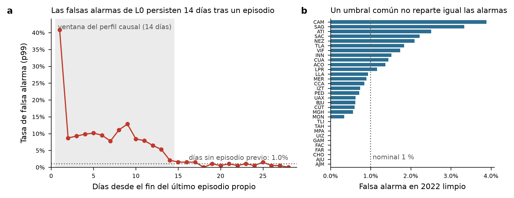

# Revisión de `lorawan11-rama-detection` y propuestas de mejora al modelo

Repositorio revisado: commit `e67edf9` (2026-10-30). Detector de referencia: **L0 («LSTM + reglas»)**,
el LSTM local compartido de la revisión 14 (ventana t−23…t, 17 columnas: relativa al perfil
causal de 14 días, máscara y columna a14 de la estación y de sus 4 vecinas, más la hora;
supervisado con 20 calendarios δ = 50 %; decisión por estación-día).

## Estado del modelo según el repositorio

- L0 le gana a V4, V4S compartido, PARAAD y TINTO con anomalías proporcionales (rev. 14–20, T1/T2).
- **Debilidades que documenta el propio repo:**
  1. Las falsas alarmas en los 14 días posteriores a un ataque propio son de 22.7 % frente a 13.6 % de R3 (rev. 14, 2024).
  2. Con error fijo en ppb, R3 (sin entrenamiento) iguala o supera a L0 con 10 y 40 ppb (rev. 21), así que L0 aprendió la *forma* proporcional.
  3. Con δ ≤ 20 % ningún detector supera claramente el azar.
  4. Los modelos memorizan rápido (mejor época 1–3).
  5. Siguen pendientes los ataques coordinados a vecinas y P4 (bit flipping).
- Las líneas que ya se descartaron con evidencia y conviene no reabrir:
  - **NO/NO₂:** cambio de −0.26 % en el p95 del residuo; el criterio era ≥ 10 %.
  - **TINTO:** F̄ de 0.322 como máximo, frente a 0.355 de L0.
  - **Modelos de red de 31 salidas:** fallaron en la rev. 13 y en T2.

  Más capacidad o más variables no es el cuello de botella.

## Diagnóstico nuevo (solo 2022 de validación, sin tocar años de examen)

Puntajes guardados de L0 δ = 50 % (`lstm_local_examen/c20/d50/seleccion/dias_2022.csv.gz`),
agregación `promedio_dia`, umbral p99 común ajustado en 2022 limpio (u = 0.0578), planes
`plan_entrenamiento_01…10`. Es descriptivo porque el umbral es del mismo año.

- **(a) Contaminación de la línea base.** En el día 1 después del episodio, la tasa de falsas alarmas es de 40.9 %.
  - En los días 2–14 queda entre 5 % y 13 %.
  - En el día 15 vuelve al nivel base de 1.0 %, justo cuando el episodio sale del perfil causal de 14 días.
  - Esos días son el 2.7 % de las estación-días normales, pero concentran el **23.1 % de todas las falsas alarmas** (282 de 1 222).
  - El mecanismo es que el perfil absorbe la lectura alterada y, al terminar el episodio, la lectura legítima parece anómala con el signo contrario.
- **(b) Heterogeneidad entre estaciones.** Con un umbral nominal común de 1 %, la tasa por estación va de 0 % a 3.9 % (CAM).
  - 10 de 31 estaciones no tienen ninguna alarma, aunque tienen entre 197 y 349 días evaluables.
  - Las alarmas, y por tanto la sensibilidad efectiva, se reparten de forma desigual entre sensores. Es justo el problema de «sensores con datos muy variables entre ellos».

## Propuestas, en orden de prioridad

### 1. Línea base protegida contra el propio ataque
- **Problema:** el panel (a) y la rev. 14. El perfil de 14 días (media o mediana) se contamina con episodios de hasta 7 días. Con la mediana, la contaminación puede llegar al 50 % de la ventana, lo que explica que la rev. 10 no lo resolviera.
- **Variantes, sin reentrenar la arquitectura:**
  - **(a) Perfil con compuerta:** las horas cuyo puntaje superó el umbral no entran al perfil, como en el control estadístico de procesos.
  - **(b) Perfil anclado en vecinas:** la base de s es la de sus vecinas más un desfase lento.
  - **(c) Doble velocidad:** un perfil de 14 días y otro de 60 días o de la misma estación del año anterior. Se usa el menos discrepante.
- **Medida de éxito:** la tasa de falsa alarma en los días 1–14 posteriores al episodio, en 2022, sin cambiar la del resto. Si los días contaminados bajaran al nivel base, el total de falsas alarmas se reduciría en torno al 21 % con el mismo umbral, lo que subiría la precisión.

### 2. Evaluar y resistir al adversario que «arrastra» la línea base (deriva lenta)
- **Riesgo:** la misma propiedad del punto 1 es una superficie de ataque. Un atacante con una rampa lenta (por ejemplo, +1–2 ppb por día) desplaza el perfil causal y la columna a14 a la vez, así que L0 y R3 pueden no verlo nunca.
  - Es el escenario más natural para el perfil Red Team y hoy no está en el protocolo (los episodios son escalones de 1 a 7 días).
- **Propuesta:**
  - agregar las familias *rampa* y *stuck-at* (valor congelado);
  - medir la frontera del «máximo daño no detectado» como en la parte 1 del README, en ppb acumulados y en cambios de banda NOM-172;
  - la defensa natural es el punto 1(c), una referencia lenta e independiente.

### 3. Entrenamiento con mezcla de familias de anomalías
- **Problema:** la rev. 21 muestra que la ventaja de L0 depende de que la anomalía se parezca a la proporcional de δ = 50 %.
- **Propuesta:**
  - entrenar con calendarios que mezclen proporcional, aditiva, rampa, stuck-at, picos y la alteración derivada del bit flipping en CayenneLPP (bits 4–7);
  - evaluar *dejando fuera una familia* para medir la generalización a ataques no vistos;
  - de paso, esto cierra P4 y conecta la tesis con su título (LoRaWAN 1.1).
- **Bonus:** más diversidad de ejemplos debería atacar la memorización (mejor época 1–3).

### 4. Calibración del umbral por estación (*Mondrian conformal* o agrupamiento parcial)
- **Problema:** el panel (b).
- **Propuesta:**
  - un umbral por estación con encogimiento hacia el común (cuantil jerárquico o conformal por estación sobre puntajes horarios, que tienen más observaciones que los diarios);
  - el objetivo es igualar la tasa de falsas alarmas entre sensores heterogéneos, que es una contribución metodológica directa al tema del paper;
  - con unos 330 días limpios por estación, un p99 por estación se apoya en unas 3 excedencias: el encogimiento es obligatorio, y lo mismo vale, con más razón, para el p99.9, ya inestable con el umbral común.

### 5. Decisión secuencial en lugar del promedio diario fijo
- **Propuesta:** CUSUM o Page-Hinkley sobre puntajes horarios calibrados, por estación.
  - Acumula evidencia en episodios de varios días (que es donde δ = 20 % queda casi en el azar).
  - No depende de que el episodio empiece a las 00 h (la rev. 16 lo probó como sensibilidad).
  - Reporta el retardo de detección.
  - No requiere reentrenar: usa los puntajes ya guardados.

### 6. Robustez espacial frente a ataques coordinados
- **Propuesta:**
  - atacar a la estación objetivo y a 1–2 de sus vecinas a la vez (pendiente declarado);
  - como defensa, una agregación robusta de vecinas: mediana de k = 6–8 en lugar de la media de 4, o pesos por correlación aprendida con 2020–2021.

### 7. Rigor de la evaluación para el paper
- **Holdout limpio:** 2025–2026 ya se usó en las revisiones 17, 18, 19 y 21, así que ya no es un examen intacto.
  - Conviene registrar un holdout nuevo de un solo uso para las propuestas 1–6, por ejemplo RAMA agosto–diciembre de 2026 cuando se publique, o 2017–2019.
  - Barcelona/AMB sirve como validación externa.
- **Semillas:** los intervalos actuales no incluyen la variación de entrenamiento. Conviene entrenar L0 definitivo con unas 5 semillas.
- **Documentación:** el README sigue describiendo el piloto CCA/V4 de 2025. Para el paper conviene un README que resuma L0, R3 y el escalafón de revisiones.

## Plan mínimo sugerido
1. Medir 1(a)–(c) con los puntajes y matrices de 2022, sin entrenar (solo cambia el perfil de las columnas de entrada; requiere volver a puntuar L0 cargado de disco).
2. Registrar en el protocolo las familias rampa y stuck-at (2) y la mezcla (3) antes de generar nada.
3. 4 y 5 son posprocesamiento barato sobre puntajes existentes y pueden ir en paralelo.
