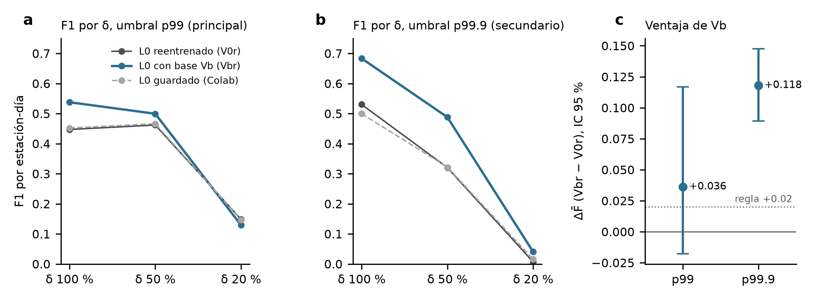

# Resultados LB1: L0 reentrenado con la línea base anclada en vecinas (Vb), 2022

- **Registro previo:** [registro_previo_LB1_reentrenamiento_Vb.md](registro_previo_LB1_reentrenamiento_Vb.md), aprobado por el tesista antes de entrenar.
- **Alcance:** exploratorio, solo 2020–2022. 2022 es a la vez validación del EarlyStopping y evaluación, así que los números son optimistas para los dos modelos por igual.
- **Archivos:** [metricas.csv](../results/linea_base/lb1/metricas.csv), [bootstrap.csv](../results/linea_base/lb1/bootstrap.csv), [modelo_V0r.keras](../results/linea_base/lb1/modelo_V0r.keras), [modelo_Vbr.keras](../results/linea_base/lb1/modelo_Vbr.keras), [historia_V0r.csv](../results/linea_base/lb1/historia_V0r.csv) y [historia_Vbr.csv](../results/linea_base/lb1/historia_Vbr.csv).

## Entrenamiento y control de reproducción
- **Datos:** los mismos que en el L0 original: 1 357 800 ventanas de entrenamiento, 339 450 de validación y 0.612 % de positivas. Las 20 matrices de entrenamiento son idénticas por SHA-256 al repo.
- **Escala a14 con V0:** reproduce la del repo con diferencia de 0.0.

| Modelo | E | Épocas | val_loss mínima |
|---|---:|---:|---:|
| L0 guardado (Colab) | 1 | 9 | 0.02245 |
| V0r (PC del tesista) | 1 | 9 | 0.02498 |
| Vbr (PC del tesista) | 1 | 9 | **0.02190** |

**Control de V0r:**
- E entre 1 y 3: ✓;
- F̄ con p99 de 0.3525 contra 0.355, dentro de ±0.03: ✓;
- val_loss dentro de ±10 %: **✗**, queda en +11.3 %.

El control se cumple a medias. Aun así, los dos L0 (guardado y V0r) dan casi el mismo F1 en los tres δ, así que V0r es un comparador válido.

## Resultados (estación-días comunes a los tres modelos)

| Umbral | Modelo | Valor del umbral | F̄ | F1 δ 100 / 50 / 20 | Recall / precisión δ 50 | M1 δ 50 | M2 δ 50 | M4 δ 50 | PR-AUC δ 100 / 50 / 20 |
|---|---|---:|---:|---|---|---:|---:|---:|---|
| p99 | V0r | 0.141 | 0.353 | 0.447 / 0.462 / 0.148 | 0.773 / 0.329 | 11.2 % | 1.01 % | 0.730 | 0.652 / 0.480 / 0.071 |
| p99 | **Vbr** | 0.130 | **0.389** | **0.538 / 0.499** / 0.129 | 0.791 / 0.365 | **4.9 %** | 1.02 % | 0.798 | **0.807 / 0.602** / 0.062 |
| p99 | L0 guardado | 0.058 | 0.355 | 0.452 / 0.466 / 0.147 | 0.776 / 0.333 | 10.7 % | 1.00 % | 0.742 | 0.626 / 0.474 / 0.068 |
| p99.9 | V0r | 0.733 | 0.286 | 0.530 / 0.320 / 0.007 | 0.214 / 0.634 | 0.23 % | 0.10 % | 0.242 | — |
| p99.9 | **Vbr** | 0.605 | **0.404** | **0.683 / 0.488 / 0.040** | 0.361 / 0.753 | 0.27 % | 0.09 % | 0.434 | — |
| p99.9 | L0 guardado | 0.427 | 0.279 | 0.500 / 0.322 / 0.016 | 0.216 / 0.635 | 0.30 % | 0.10 % | 0.225 | — |

M1 son las falsas alarmas a 1–14 días del fin de un episodio propio, M2 el resto de días normales y M4 el recall en el día ≥ 3 de un episodio.

**Bootstrap pareado de ΔF̄ (Vbr − V0r)** (2000 remuestreos de bloques estación-mes, umbrales fijos):

| Umbral | ΔF̄ | IC 95 % |
|---|---:|---|
| p99 (principal) | **+0.036** | [−0.018, +0.117] |
| p99.9 (secundario) | **+0.118** | [+0.089, +0.148] |

## Regla de avance registrada

| Condición | Resultado |
|---|---|
| ΔF̄ con p99 ≥ +0.02 en el valor puntual | ✓ +0.036 |
| El IC 95 % con p99 no incluye valores menores de 0 | **✗**, el límite inferior es −0.018 |
| M1 de Vb con δ = 50 % ≤ la mitad del de V0r | ✓ 4.9 % contra 11.2 % (0.43 veces) |

**Vb no pasa la regla registrada.** La ventaja con p99 es positiva, pero el intervalo todavía incluye el 0.

La ventaja con p99.9 (+0.118, con un intervalo lejos de 0) es grande. Según lo registrado, se reporta como **observación secundaria, no adoptable**, porque el umbral p99.9 descansa en unas 11 excedencias limpias.

## Predicciones (6)

| # | Predicción | Resultado |
|---|---|---|
| 1 | V0r cumple el control | A medias: la val_loss queda en +11.3 % |
| 2 | M1 de Vb ≤ 4 % y de V0r entre 8 y 13 % | A medias: Vb da 4.9 % y V0r 11.2 % |
| 3 | Umbral p99 de Vb < 1.3 veces el de V0r | ✓ 0.92 veces: el reentrenamiento corrigió la calibración |
| 4 | ΔF̄ con p99 entre 0 y +0.04 | ✓ +0.036 |
| 5 | ΔF̄ con p99.9 mayor que con p99 | ✓ +0.118 contra +0.036 |
| 6 | PR-AUC de Vb con δ = 50 % ≥ al de V0r | ✓ 0.602 contra 0.480 |

## Lectura
1. **Reentrenar resolvió la calibración que fallaba con el modelo congelado.** El p99 limpio de Vb ya no se dispara (0.130 contra 0.141).
2. **Vb aporta más que quitar las falsas alarmas tras un episodio.** También mejora el orden de los puntajes: PR-AUC de 0.807 contra 0.652 con δ = 100 % y de 0.602 contra 0.480 con δ = 50 %. Y sube el recall en los días tardíos del episodio (M4 de 0.798 contra 0.730).

   Es coherente con que la línea base de vecinas no se acostumbra al ataque durante el episodio.
3. **Con δ = 20 % Vb no ayuda:** F1 de 0.129 contra 0.148 y PR-AUC de 0.062 contra 0.071. Esta anomalía sigue cerca del límite de detección.
4. **El intervalo ancho con p99** ([−0.018, +0.117]) indica que la ventaja depende de pocos bloques estación-mes. El desglose por δ del bootstrap no se pudo ejecutar en esta sesión porque requiere la aprobación del usuario. Queda pendiente.
5. **Con p99.9**, que es el punto de operación que el asesor aceptó para quien no puede verificar alarmas, Vb encuentra con δ = 50 % el 36 % de las estación-días atacadas con 75 % de precisión, contra 21 % y 63 % de V0r.

## Siguientes pasos posibles (requieren decisión)
- **A.** Registrar un protocolo de examen para Vb sobre un holdout nuevo de un solo uso, con p99 y p99.9 como coprincipales y declarando las dos pruebas.
  - Holdout posible: RAMA de agosto a diciembre de 2026 cuando se publique, o 2017–2019.
  - Es lo que permitiría afirmar la ventaja.
- **B.** Antes de A, más semillas para Vbr y V0r (por ejemplo 5). Con E = 1, la variación entre semillas puede ser del tamaño de la ventaja con p99.
- **C.** Combinar Vb con la estandarización por estación (P4 y P5 rediseñados) en la misma revisión.
