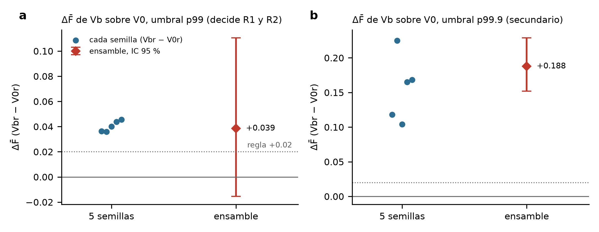

# Resultados LB2: semillas y ensamble de Vbr y V0r (2022)

- **Registro previo:** [registro_previo_LB2_semillas_ensamble.md](registro_previo_LB2_semillas_ensamble.md), aprobado por el tesista antes de entrenar.
- **Script:** `experiments/linea_base/lb2.py`, que produce `results/linea_base/lb2/`.
- **Cómputo:** 8 modelos nuevos entrenados en el PC del tesista (CPU AMD Ryzen 7 7700X), 108 minutos en total. Todos ven las mismas 1 357 800 ventanas.
- **Épocas elegidas:** V0r, E = 1 en las 4 semillas. Vbr, E = 1, 2, 2 y 1 (semillas 1–4).

## R1, robustez entre semillas: **pasa**
ΔF̄ con p99 (Vbr − V0r) es **positivo en las 5 semillas**, con una media de **+0.040** (de +0.036 a +0.046).

| Semilla | F̄ V0r | F̄ Vbr | ΔF̄ (p99) | ΔF̄ (p99.9) |
|---:|---:|---:|---:|---:|
| 42 | 0.353 | 0.389 | +0.036 | +0.118 |
| 1 | 0.357 | 0.393 | +0.036 | +0.225 |
| 2 | 0.345 | 0.385 | +0.040 | +0.104 |
| 3 | 0.354 | 0.397 | +0.044 | +0.165 |
| 4 | 0.363 | 0.409 | +0.046 | +0.168 |

## R2, ensamble: **no pasa**
- Con p99: Ens-Vbr − Ens-V0r, ΔF̄ = **+0.039**, IC [−0.016, +0.111]. El intervalo incluye valores menores de 0.
- Con p99.9 (secundario, no adoptable): ΔF̄ = **+0.188**, IC [+0.152, +0.229].

| Umbral | Modelo | F̄ | F1 δ 100 / 50 / 20 | Recall / precisión δ 50 | M1 δ 50 |
|---|---|---:|---|---|---:|
| p99 | Ens-V0r | 0.361 | 0.451 / 0.467 / 0.164 | 0.806 / 0.329 | 13.7 % |
| p99 | **Ens-Vbr** | **0.399** | 0.542 / 0.512 / 0.144 | 0.833 / 0.370 | 5.5 % |
| p99.9 | Ens-V0r | 0.252 | 0.457 / 0.287 / 0.014 | 0.188 / 0.607 | 0.19 % |
| p99.9 | **Ens-Vbr** | **0.440** | **0.752** / 0.541 / 0.027 | 0.413 / 0.783 | 0.27 % |

**Ensamble frente a una sola semilla (semilla 42):**
- Vbr: +0.010 con p99, IC [−0.019, +0.034]; +0.036 con p99.9, IC [+0.020, +0.053].
- V0r: +0.008 con p99; −0.034 con p99.9.

## Predicciones (5)

| # | Resultado |
|---|---|
| 1. ≥ 7 de 8 con E de 1 o 2 | ✓ 8 de 8 |
| 2. ΔF̄ > 0 en ≥ 4 de 5 semillas | ✓ 5 de 5 |
| 3. Ensamble con ΔF̄ entre +0.02 y +0.06 y un IC sin valores menores de 0 | A medias: el valor sí (+0.039), el IC no |
| 4. El ensamble sube F̄ ≥ 0.01 frente a la media de sus semillas | ✗ +0.006 (V0r) y +0.005 (Vbr) |
| 5. Ens-Vbr con p99.9 llega a F1 ≥ 0.68 con δ = 100 % | ✓ 0.752 |

## Lectura
1. **La ventaja de Vb no es azar del entrenamiento.** Las 5 semillas dan entre +0.036 y +0.046 con p99. La dispersión entre semillas (0.010) es mucho menor que el ancho del IC del bootstrap (0.13).
2. **El IC ancho con p99 viene de los datos de 2022, no de los modelos.** El bootstrap remuestrea bloques estación-mes, y con ~0.8 % de días atacados hay pocos bloques que pesan mucho. Agregar más semillas no lo estrecharía. Solo lo haría evaluar más datos, como el examen final con más estación-días o varios años.
3. **Con p99.9, el ensamble de Vbr es el mejor detector medido hasta ahora:** F1 = 0.752 con δ = 100 % (recall 0.681, precisión 0.840) y 0.541 con δ = 50 %, con precisión de 0.78 en δ = 50 %. Para δ = 100 % entra en la meta de F1 0.70–0.80 del asesor, todavía sobre 2022, que es optimista.
4. **El ensamble ayuda a Vbr con p99.9 (+0.036, IC por encima de 0)**, pero casi nada con p99, y a V0r lo perjudica con p99.9.

## Siguiente paso propuesto
Llevar **Ens-Vbr** (y Ens-V0r como comparador) al **examen final** registrado sobre un holdout de un solo uso, con p99 y p99.9 declarados como dos pruebas. Es la evaluación que puede estrechar el intervalo, y la que da la cifra para el paper.
