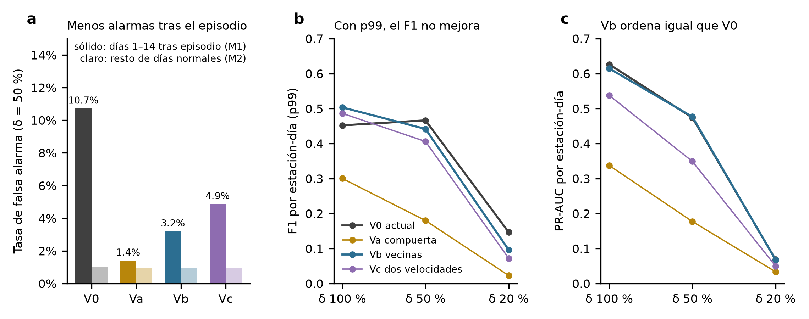

# Resultados: línea base protegida (P1), umbral por estación (P4) y CUSUM (P5), 2022

- **Registro previo:** [registro_previo_linea_base_2022.md](registro_previo_linea_base_2022.md), aprobado por el tesista antes de calcular.
- **Alcance:** exploratorio, solo 2022.
- **Modelo:** L0 de selección δ = 50 %, cargado de disco. No se entrenó nada.
- **Tablas:** [p1_metricas.csv](../results/linea_base/exploracion_2022/p1_metricas.csv) y [p4_p5.csv](../results/linea_base/exploracion_2022/p4_p5.csv).

## Controles
- **Matrices:** las 31 son idénticas por SHA-256 a `resumen_matrices.csv`.
- **Reproducción:** V0 reproduce los 11 conjuntos δ = 50 % de `dias_2022.csv.gz`, con una diferencia máxima de 3.7 × 10⁻⁸.
- **Constructor de entradas:** el propio da las mismas 98 columnas que `ev.entradas_de`, con diferencia de 0.0.

## P1: tres variantes de línea base

| Variante | Umbral p99 | F1 δ 100 / 50 / 20 | F̄ | PR-AUC δ 100 / 50 / 20 | M1 δ 50 | M2 δ 50 | M4 δ 50 | FA día 1, δ 50 |
|---|---:|---|---:|---|---:|---:|---:|---:|
| V0 actual | 0.058 | 0.452 / 0.466 / 0.147 | **0.355** | 0.626 / 0.474 / 0.068 | 10.7 % | 1.00 % | 0.742 | 40.9 % |
| Va compuerta | 0.429 | 0.300 / 0.180 / 0.023 | 0.168 | 0.337 / 0.177 / 0.034 | 1.4 % | 0.95 % | 0.239 | 3.2 % |
| Vb vecinas | 0.133 | **0.503** / 0.442 / 0.096 | 0.347 | 0.615 / **0.477** / 0.068 | 3.2 % | 0.97 % | 0.690 | 30.1 % |
| Vc dos velocidades | 0.118 | 0.486 / 0.406 / 0.072 | 0.321 | 0.538 / 0.349 / 0.050 | 4.9 % | 0.98 % | 0.580 | 25.8 % |

M1 son los días 1–14 tras un episodio propio, M2 el resto de días normales y M4 el recall en el día ≥ 3 de un episodio.

**Criterio registrado** (M1 baja a la mitad, M2 no sube más de 0.2 pp, F̄ no baja): **ninguna variante pasa.** Las tres cumplen M1 y M2 y fallan en F̄.

**Lectura:**
- **Vb es la más prometedora.**
  - Reduce M1 de 10.7 % a 3.2 % (−70 %) sin mover M2.
  - Su PR-AUC es prácticamente igual al de V0 en los tres δ: L0 ordena los días igual de bien.
  - Su F̄ baja solo 0.008, y lo hace porque la cola de los puntajes en 2022 limpio se alarga: el p99 sube de 0.058 a 0.133, y con un umbral más alto se pierde recall.
  - Es la firma esperada de un modelo **congelado** que recibe entradas un poco distintas a las de su entrenamiento. Es un problema de calibración, no de capacidad para separar.
- **Va falla por bloqueo.**
  - En 2022 limpio excluyó 285 estación-días y activó el tope de 10 días 17 veces; en total, 529 veces.
  - Una línea base que deja de actualizarse se aleja de los datos legítimos y produce más alertas, que a su vez la siguen congelando. El p99 sube a 0.429.
  - Es el riesgo de bloqueo anticipado en el registro, ahora medido.
  - **Lectura de seguridad:** una línea base con retroalimentación es frágil, y un atacante podría provocar alertas a propósito para congelarla.
- **Vc** reduce M1 a la mitad, pero ordena peor (PR-AUC 0.349 contra 0.474 con δ = 50 %). La mediana de 60 días llega tarde a los cambios legítimos.

**Predicciones (de 5):**

| # | Predicción | Resultado |
|---|---|---|
| 1 | Va y Vc reducen M1 a la mitad; Vb menos | A medias: Va y Vc sí, pero Vb lo reduce más que Vc |
| 2 | Día 1 > 15 % en todas | Falla: Va baja a 3.2 % |
| 3 | Vb es la que más mueve M2 | Falla: la que más lo mueve es Va, y los cambios son pequeños |
| 4 | Cambio de F̄ entre −0.01 y +0.03 | A medias: solo se cumple en Vb (−0.008) |
| 5 | M4 sube en Va y Vc | Falla: baja, por el umbral más alto |

## P4: umbral por estación (puntajes V0, ajuste cruzado por meses)

| | DE de la tasa de FA entre estaciones | Estaciones con 0 % | Estaciones con > 2 % | F̄ |
|---|---:|---:|---:|---:|
| Umbral común (cruzado) | 0.0106 | 10 | 5 | 0.358 |
| Umbral por estación, w = n/(n + 200) | 0.0084 | 8 | 4 | 0.353 |

**Predicciones:**
- la DE baja al menos 30 %: **falla**, solo baja 21 %;
- el F̄ cambia menos de ±0.02: **se cumple** (−0.005).

**Lectura:** la mejora es modesta. Con unos 165 días de ajuste por estación, el encogimiento deja cada umbral cerca del común. Igualar sensores más a fondo requiere más días limpios o puntajes horarios.

## P5: CUSUM con k común (puntajes V0)

| | F1 δ 100 / 50 / 20 | F̄ | M1 δ 50 | Episodios detectados, δ 50 | Retardo mediano |
|---|---|---:|---:|---:|---:|
| Umbral diario V0 (cruzado) | 0.455 / 0.468 / 0.152 | 0.358 | 10.8 % | 79.3 % | 1 día |
| CUSUM | 0.057 / 0.055 / 0.017 | 0.043 | 33.1 % | 23.3 % | 4 días |

Los episodios son 227, todos los que empiezan en 2022.

**Predicciones:**
- el F1 con δ = 20 % sube: **falla**;
- M1 empeora: **se cumple**.

**Lectura (mecanismo verificado):**
- La fracción de días limpios con log(puntaje) > k va de 0.5 % a 20 % según la estación.
- Con un k común, las estaciones con puntaje crónicamente alto acumulan S sin parar: CAM, SAG y NEZ concentran el 66 % de las alarmas limpias.
- Es la heterogeneidad entre sensores del panel (b) del diagnóstico, **amplificada por la acumulación**. Un CUSUM útil necesita estandarizar el puntaje por estación antes de acumular, y eso sería una revisión nueva.

## Conclusión y siguiente paso propuesto
1. No se adopta ninguna variante con el modelo congelado.
2. **Vb merece una revisión con reentrenamiento:**
   - L0 con entradas Vb;
   - selección con 2020–2021 y validación con 2022, con el mismo protocolo de la revisión 14, en Colab.

   La evidencia es que Vb elimina el 70 % del exceso de alarmas tras el episodio, conserva el PR-AUC, y su pérdida de F1 se explica por calibración, no por capacidad de separar.
3. P4 queda como mejora menor y opcional.
4. P5 se rediseña con estandarización por estación antes de volver a probarlo.
5. Va se documenta como resultado negativo, con implicación de seguridad: el bloqueo de la línea base por retroalimentación.
