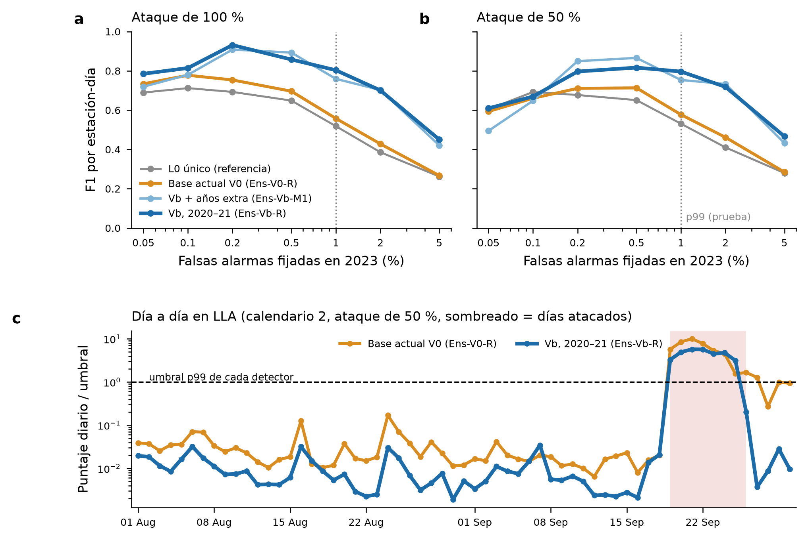

# Resultados de la revisión 22: examen de despliegue (agosto–septiembre de 2026, uso único)

Fecha: 2026-11-07. Registro: `registro_previo_rev22_mas_anios.md` (§5 y addendum §8).

**En una línea:** con la prueba registrada (p99), **Ens-Vb-R y Ens-Vb-M1 superan a Ens-V0-R**:
- Ens-Vb-R: ΔF̄ +0.188, IC 97.5 % [+0.059, +0.322];
- Ens-Vb-M1: ΔF̄ +0.153, IC 97.5 % [+0.013, +0.296].

Con p99.9 (descriptivo) no hay diferencia.

## Cómo se corrió
- **Datos:**
  - historia validada de enero–julio de 2026 (zip de SIMAT);
  - ventana del 2026-08-01 al 2026-09-30 con datos **crudos de SINAICA**, porque SIMAT está en mantenimiento (addendum §8).
- **Ataques:** 10 calendarios (números 801–810) con 46 episodios, de los que 39 son evaluables. δ = 100, 50, 20, 10 y 5 %.
- **Unidades:** 1 367 estación-días limpias, comunes a los cuatro detectores.
- **Umbrales:** 2023 limpio (`umbrales_2023.csv`), reproducidos exactamente.
- **Modelos:** 15 definitivos, con su SHA-256 verificado, más L0 único.
- **Reproducibilidad:** las dos corridas de inferencia salieron **idénticas** (diferencia 0.0). Cada una tardó 8 min.

## Resultados

| Detector | Umbral | FA lograda (alarmas) | F̄ | F1 δ100 (R / P) | F1 δ50 (R / P) | F1 δ20 | F1 δ10 |
|---|---|---|---:|---|---|---:|---:|
| Ens-V0-R (comparador) | p99 | 0.7 % (10) | 0.448 | 0.558 (0.97 / 0.39) | 0.577 (0.87 / 0.43) | 0.208 | 0.047 |
| **Ens-Vb-R** | p99 | 0.2 % (3) | **0.636** | **0.803** (0.98 / 0.68) | **0.796** (0.91 / 0.71) | 0.307 | 0.022 |
| Ens-Vb-M1 | p99 | 0.4 % (5) | 0.601 | 0.759 (0.97 / 0.62) | 0.754 (0.91 / 0.64) | 0.291 | 0.020 |
| L0 único (referencia) | p99 | 1.0 % (13) | 0.415 | 0.519 (0.96 / 0.36) | 0.531 (0.85 / 0.39) | 0.195 | 0.064 |
| Ens-V0-R | p99.9 | 0 % (0) | 0.484 | 0.778 (0.77 / 0.79) | 0.661 (0.50 / 0.97) | 0.014 | 0.000 |
| Ens-Vb-R | p99.9 | 0 % (0) | 0.508 | 0.815 (0.69 / 0.99) | 0.670 (0.51 / 0.99) | 0.040 | 0.000 |
| Ens-Vb-M1 | p99.9 | 0 % (0) | 0.481 | 0.780 (0.64 / 0.99) | 0.648 (0.48 / 1.00) | 0.014 | 0.000 |
| L0 único | p99.9 | 0 % (0) | 0.490 | 0.712 (0.68 / 0.75) | 0.693 (0.55 / 0.94) | 0.066 | 0.000 |

La curva completa de 0.05 a 5 % está en `curva_operacion.csv`.

Comprobación sin umbral (PR-AUC, δ100 / δ50 / δ20): Ens-Vb-R 0.979 / 0.930 / 0.291; Ens-Vb-M1 0.971 / 0.935 / 0.292; Ens-V0-R 0.864 / 0.820 / 0.169; L0 único 0.795 / 0.761 / 0.161 (`prauc_descriptivo.csv`).

**Prueba registrada** (p99, IC 97.5 %, bootstrap de bloques estación × mes):

| Candidato | ΔF̄ p99 [IC 97.5 %] | Adopta | ΔF̄ p99.9 (descriptivo) |
|---|---|---|---|
| Ens-Vb-R | +0.188 [+0.059, +0.322] | Sí | +0.024 [−0.031, +0.072] |
| Ens-Vb-M1 | +0.153 [+0.013, +0.296] | Sí | −0.003 [−0.066, +0.051] |

**Los dos cumplen, y el registro no dice cuál elegir si pasan ambos.**
- Propuesta: aplicar el mismo criterio de la elección, el mayor ΔF̄ en p99. Eso da **Ens-Vb-R**, que además es el más simple, porque no usa años extra.
- La decisión es del tesista y se anota como no registrada de antemano.

## Vista de despliegue (descriptiva, p99)
- **Mes a mes, falsas alarmas en limpio:**
  - Ens-V0-R: 1.1 % en agosto y 0.4 % en septiembre;
  - Ens-Vb-R: 0.2 % y 0.3 %;
  - L0 único: 1.4 % y 0.6 %.
- **Mes a mes, recall con δ = 100 %:** entre 0.95 y 1.00 en todos los detectores.
- **Día de la primera alerta:** de los 38 episodios detectados con δ = 100 %, Ens-Vb-R detecta 34 el primer día y Ens-V0-R 33. La mediana es el día 1 para todos.
- **Hora a hora** (media acumulada del día desde la hora 12):
  - mediana de horas desde el inicio del ataque hasta la alerta con δ = 100 %: Ens-Vb-R 14 h, Ens-V0-R 14 h, Ens-Vb-M1 13 h y L0 único 15 h;
  - con δ = 50 %: de 15 a 16 h;
  - las falsas alarmas de esa regla en limpio son de 0.3 % (Ens-Vb-R) y 1.1 % (Ens-V0-R).

## Predicciones del registro
6. Ningún candidato cumple la regla de adopción: **no se cumplió.** Los dos la cumplen.
7. Las falsas alarmas logradas de Ens-V0-R con p99 quedan entre 0.5 y 1.5 %: **se cumplió** (0.7 %).
8. La mediana de horas hasta la primera alerta con δ = 100 % es ≤ 24 h: **se cumplió** (14 h).

## Lectura
1. **La ventaja de Vb con p99 viene de la precisión, no del recall.**
   - El recall es casi el mismo (0.98 contra 0.97 con δ = 100 %).
   - Vb da muchas menos falsas alarmas: 3 contra 10 en limpio, y menos días normales marcados en los calendarios atacados.
2. **La figura (panel c) muestra el mecanismo.** Después de un episodio, la base de 14 días de V0 queda contaminada y sigue disparando varios días. La base anclada en vecinas de Vb regresa enseguida. Es el exceso de falsas alarmas tras un episodio (M1) que se diagnosticó al inicio.
3. **Con p99.9, los cuatro detectores empatan.** A ese umbral casi no hay falsas alarmas para ninguno, y la ventaja de precisión desaparece.
4. **Con p99, Ens-Vb-R entra en la meta del asesor:** F1 de 0.80 con ataques del 100 % y del 50 %.
5. **Más años de fondo no le suman a Vb en el examen:** Ens-Vb-M1 queda por debajo de Ens-Vb-R.

## Límites declarados
- **Muestra chica:** dos meses, 39 episodios evaluables y 1 367 estación-días limpias. Los IC son anchos.
- **Datos crudos sin validar.** Cuando SIMAT publique el zip validado, se recalcula como comprobación, sin nuevas decisiones.
- **Antecedente:** la receta de Vb-R (Ens-Vbr) **no se adoptó en 2017–2019** (ΔF̄ p99 +0.004 [−0.042, +0.057]).
  - Hacia adelante en el tiempo, en despliegue, la ventaja aparece; hacia atrás, no.
  - La conclusión honesta para la tesis es que **la ventaja de Vb depende del periodo**, y en particular de cómo se trasladan sus umbrales: en 2017–2019 dio más falsas alarmas de las fijadas, aquí menos.
- **Faltan detectores de referencia:** L0 por δ, R3 y V4 se agregan después como tabla descriptiva.

Salidas en `results/linea_base/rev22/examen_despliegue/`:
- `curva_operacion.csv`, `pruebas.csv`, `decision.json`;
- `vista_mensual.csv`, `primera_alerta.csv`, `horas_primera_alerta.csv`;
- `planes/` y `corrida_a/`; `corrida_b/` es idéntica y no se versiona.

## Decisión del tesista (2026-11-07, después del examen)
- **Se adopta Ens-Vb-R como detector principal.** Es la media de 5 modelos L0 con la base anclada en vecinas (Vb), entrenados con 2020–2021 y, en su versión definitiva, con 2020–2022.
- **Desempate:** los dos candidatos cumplieron la regla registrada, que no fijaba cuál adoptar en ese caso. Se usó el mismo criterio de la elección: el mayor ΔF̄ en p99. Este desempate **no estaba registrado de antemano** y así se declara.
- **Alcance de la adopción:**
  - la ventaja está en el punto p99;
  - con p99.9 los detectores empatan;
  - en 2017–2019 la misma receta no ganó, y eso se reporta junto como dependencia del periodo.
- **Comprobaciones posteriores (sin nuevas decisiones):**
  - el examen recalculado con el zip validado de SIMAT cuando se publique;
  - las siguientes ventanas de despliegue, de octubre de 2026 en adelante, cada una con su registro.

## Referencia: PARAAD-SA en la misma ventana (descriptivo, 2026-11-07)

**Cómo:**
- Es el modelo congelado de la revisión 20 (`modelo_r1.keras`, SHA-256 `1e859d91…`), con su escala 2020–2022 y sus umbrales de 2023 (p99 = 0.6405, p99.9 = 0.8366, comparación estricta `>`). No se entrenó ni se recalibró nada.
- **Desvío:** el puntuador oficial (`puntuar_paraad.py`) exige Keras 3.13.2 y aquí hay 3.15.1. Se usaron las mismas funciones de `src/detect/paraad.py` (`bloques`, `reconstruir`, `puntajes`). El SHA-256 del modelo, de la escala y del código coincide con lo congelado; la escala y el código, comparados con finales de línea LF.
- **Control:** la calibración de 2023 se reproduce. Son 8 802 estación-días, con diferencia máxima de 1.4e-6 y **decisiones idénticas** con p99 y p99.9 (88 alertas con p99, como en la revisión 20).
- **Mismas condiciones que los demás detectores:** los 10 calendarios, las mismas 1 367 estación-días limpias (PARAAD las cubre todas) y dos corridas idénticas.

| Detector | Umbral | FA limpia (alarmas) | F̄ | F1 δ100 (R / P) | F1 δ50 | F1 δ20 | PR-AUC δ100 / δ50 / δ20 |
|---|---|---|---:|---|---:|---:|---|
| Ens-Vb-R | p99 | 0.2 % (3) | 0.636 | 0.803 (0.98 / 0.68) | 0.796 | 0.307 | 0.979 / 0.930 / 0.291 |
| Ens-V0-R | p99 | 0.7 % (10) | 0.448 | 0.558 (0.97 / 0.39) | 0.577 | 0.208 | 0.864 / 0.820 / 0.169 |
| L0 único | p99 | 1.0 % (13) | 0.415 | 0.519 (0.96 / 0.36) | 0.531 | 0.195 | 0.795 / 0.761 / 0.161 |
| **PARAAD-SA** | p99 | 0.1 % (1) | 0.408 | 0.710 (0.60 / 0.88) | 0.476 | 0.038 | 0.726 / 0.444 / 0.044 |
| Ens-Vb-R | p99.9 | 0 % | 0.508 | 0.815 | 0.670 | 0.040 | — |
| **PARAAD-SA** | p99.9 | 0 % | 0.289 | 0.654 | 0.198 | 0.014 | — |

**ΔF̄ contra PARAAD** (IC 95 % descriptivo, bootstrap estación × mes, semilla [42, 22, 2]):

| Detector | p99 | p99.9 |
|---|---|---|
| Ens-Vb-R | **+0.228 [+0.062, +0.381]** | **+0.220 [+0.135, +0.303]** |
| Ens-V0-R | +0.040 [−0.121, +0.201] | +0.196 [+0.113, +0.285] |
| L0 único | +0.007 [−0.147, +0.174] | +0.202 [+0.125, +0.284] |

**Lectura:**
- **Ens-Vb-R supera a PARAAD con los dos umbrales,** y también sin umbral (PR-AUC).
- **PARAAD es muy preciso con ataques grandes:** con p99 y δ100, precisión de 0.88 y una sola falsa alarma en limpio. Pero detecta poco (recall de 0.60), y cae mucho con δ50 y δ20.
- **Con p99 y δ100, PARAAD supera a V0 y a L0 único** (0.710 contra 0.558 y 0.519). Es un matiz frente a la revisión 20, donde L0 le ganaba en todas las combinaciones de δ100 y δ50.
- **Advertencia de justicia:** Ens-Vb-R se entrenó con ataques del mismo tipo que el examen (error proporcional), y PARAAD no ve etiquetas, porque está pensado para sesgo y deriva. La comparación mide desempeño práctico en este escenario; no demuestra que una arquitectura sea superior. El escenario D1 (sesgo y deriva) sería la prueba en el terreno de PARAAD.
- **Salidas:** `paraad_diario.npz`, `paraad_comparacion.csv` y `paraad_intervalos.csv`.
