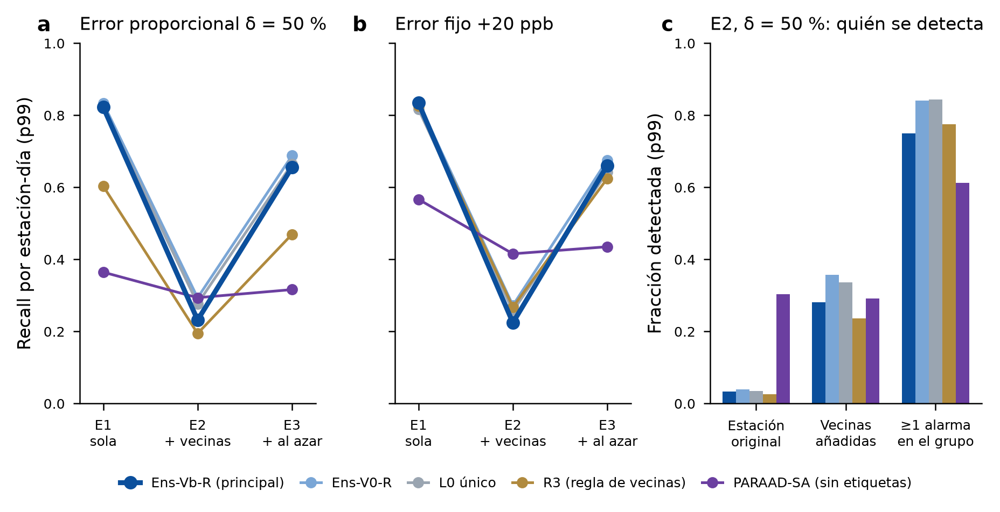

# Resultados de la revisión 23: ataque coordinado y error fijo en ppb

Fecha: 2026-11-07. Registro: [registro_previo_rev23_ataque_coordinado.md](registro_previo_rev23_ataque_coordinado.md), aprobado antes de generar planes y con sus precisiones al final. Es una descripción de detectores congelados: no se eligió ni se cambió ningún modelo.

**Veredicto en una línea.** Si el atacante altera a la vez una estación y sus 4 vecinas, la estación atacada se vuelve casi invisible para **todos** los detectores que comparan con las vecinas: Ens-Vb-R, Ens-V0-R, L0 único y R3, con recall de 0.02–0.07. Ens-Vb-R pierde más que Ens-V0-R. PARAAD, que no usa vecinas, casi no se inmuta. Con el mismo número de estaciones elegidas al azar la caída es mucho menor. El punto ciego está en las vecinas, no en atacar muchas estaciones a la vez.

*Figura.* Recall por estación-día con el umbral p99 de 2023, en el banco 2024–jul 2026 (30 calendarios).
- **a** Error proporcional δ = 50 %.
- **b** Error fijo de +20 ppb.
- E1: sólo la estación del episodio (1 741 estación-días alteradas evaluables). E2: la estación y sus vecinas de Vb alterables (8 741). E3: la estación y el mismo número de estaciones al azar que no son sus vecinas (8 459).
- **c** E2 con δ = 50 %: recall de la estación original y de las vecinas añadidas, y fracción de los 585 ataques coordinados con al menos una alarma en alguna estación del grupo mientras dura.

## Qué se corrió
- **Matrices:** 573 por corrida, 570 alteradas y 3 años limpios. Son 30 calendarios × (E1 con 7 tamaños + E2 y E3 con 6). Detectores: Ens-Vb-R, Ens-V0-R, L0 único, R3 y PARAAD-SA.
- **Dos corridas idénticas:** diferencia 0.0 en los 573 archivos y los mismos SHA-256 de contenido (`puntajes_sha256.json`). Cada corrida tardó 80 min en 4 procesos × 4 hilos.
- **Inferencia idéntica bit a bit a la de la calibración.** En 2023 reproduce los puntajes de la revisión 22 con diferencia 0.0 y las mismas alarmas (90 con p99, 9 con p99.9).
  - XLA no cumplió el criterio declarado y no se usó (91 alarmas en vez de 90; ver el registro).
  - Puntuar sólo las horas con dato y sólo las ventanas que cambian dio diferencia 0.0 frente a la puntuación completa.
- **R3 corre sin cambios:** reproduce los puntajes de 2023 de la revisión 20 (diferencia 0) y las alarmas en limpio de la revisión 18 en 2024, 2025 y 2026.
- **PARAAD:** diferencia de 1.4e-6 con el entorno congelado, como en la revisión 22. Hay 7 estación-días con puntaje a menos de 1e-5 de su umbral p99; su decisión podría cambiar con Keras 3.13.2.
- **Cambio real medio en las horas de episodio con dato**, el mismo en los tres escenarios:

| Tamaño | 5 ppb | 10 ppb | 20 ppb | 40 ppb | δ 20 % | δ 50 % | δ 100 % |
|---|---|---|---|---|---|---|---|
| Cambio real (ppb) | 4.79 | 9.28 | 17.65 | 32.22 | 6.10 | 14.12 | 25.05 |

## Recall con p99 (umbral de 2023)
| Escenario | Detector | δ 100 | δ 50 | δ 20 | 10 ppb | 20 ppb | 40 ppb |
|---|---|---|---|---|---|---|---|
| E1 sola | Ens-Vb-R | 0.95 | 0.82 | 0.20 | 0.23 | 0.83 | 0.97 |
| | Ens-V0-R | 0.94 | 0.83 | 0.23 | 0.27 | 0.84 | 0.95 |
| | L0 único | 0.91 | 0.82 | 0.24 | 0.27 | 0.82 | 0.91 |
| | R3 | 0.84 | 0.60 | 0.14 | 0.37 | 0.83 | 0.94 |
| | PARAAD | 0.68 | 0.36 | 0.09 | 0.10 | 0.57 | 0.92 |
| E2 + vecinas | Ens-Vb-R | 0.36 | 0.23 | 0.06 | 0.06 | 0.22 | 0.39 |
| | Ens-V0-R | 0.43 | 0.29 | 0.07 | 0.08 | 0.27 | 0.44 |
| | L0 único | 0.38 | 0.28 | 0.07 | 0.08 | 0.26 | 0.38 |
| | R3 | 0.28 | 0.19 | 0.05 | 0.10 | 0.27 | 0.33 |
| | PARAAD | 0.61 | 0.29 | 0.07 | 0.07 | 0.42 | 0.87 |
| E3 + al azar | Ens-Vb-R | 0.80 | 0.66 | 0.16 | 0.18 | 0.66 | 0.85 |
| | Ens-V0-R | 0.82 | 0.69 | 0.19 | 0.22 | 0.68 | 0.84 |
| | L0 único | 0.77 | 0.66 | 0.20 | 0.23 | 0.64 | 0.76 |
| | R3 | 0.63 | 0.47 | 0.12 | 0.29 | 0.62 | 0.71 |
| | PARAAD | 0.62 | 0.32 | 0.08 | 0.08 | 0.44 | 0.88 |

Con 5 ppb (sólo en E1), ningún detector pasa de 0.05.

**En E2, por papel (p99):**
- **Estación original:**
  - Ens-Vb-R 0.02–0.05, Ens-V0-R 0.02–0.07, L0 único 0.02–0.07 y R3 0.02 en todos los tamaños. Es casi la tasa de falsas alarmas.
  - PARAAD conserva lo que tenía en E1: 0.62 (δ100), 0.30 (δ50) y 0.87 (40 ppb).
- **Detección del ataque, con al menos una alarma en el grupo (δ50 / 20 ppb):** Ens-Vb-R 0.75/0.74, Ens-V0-R 0.84/0.85, L0 único 0.84/0.82, R3 0.78/0.92 y PARAAD 0.61/0.78.
  - El operador se entera de la mayoría de los ataques coordinados fuertes por las estaciones de la periferia, cuyas propias vecinas no están todas alteradas.
  - Pero no por la estación atacada.

## Preguntas declaradas (p99; IC del 95 %, bootstrap pareado estación × mes)
| | Medida | p99 | p99.9 (descriptivo) | Lectura |
|---|---|---|---|---|
| **Q1** | ΔF̄ Ens-Vb-R − Ens-V0-R en E2 | −0.026 [−0.040, −0.012] | −0.044 [−0.054, −0.035] | **Se invierte:** con ataque coordinado, Ens-V0-R es mejor |
| **Q2** | Caída de recall E1→E2 (δ50), Vb − V0 | +0.050 [+0.020, +0.080] | −0.005 [−0.039, +0.025] | Vb cae más con p99 (0.59 frente a 0.54) |
| **Q3** | ΔF̄ppb Ens-Vb-R − R3 en E1 | −0.017 [−0.066, +0.041] | +0.021 [−0.031, +0.071] | Empate |
| **Q4** | ΔF̄ppb Ens-Vb-R − Ens-V0-R en E1 | +0.020 [−0.025, +0.073] | +0.043 [−0.004, +0.091] | Empate |

Caídas de recall E1→E2 con δ = 50 % y p99:
- Ens-Vb-R 0.59 [0.55, 0.63], Ens-V0-R 0.54 [0.51, 0.58] y R3 0.41 [0.37, 0.45].
- PARAAD 0.07 [0.03, 0.11].
- De E1 a E3 bajan mucho menos: Ens-Vb-R 0.17 y Ens-V0-R 0.15.

## Predicciones (registradas antes de generar nada)
| # | Predicción | Valor | ¿Se cumple? |
|---|---|---|---|
| 1 | El recall de Ens-Vb-R (δ50) baja ≥ 0.10 de E1 a E2 | baja 0.59 | ✓ (mucho más de lo previsto) |
| 2 | Ens-V0-R también baja, pero menos | baja 0.54; diferencia +0.050 | ✓ |
| 3 | En E3 las caídas son menores que en E2 | 0.17 y 0.15 frente a 0.59 y 0.54 | ✓ |
| 4 | Q1: Vb pierde su ventaja (el IC incluye 0) | IC [−0.040, −0.012] | ✗ Peor: se invierte |
| 5 | PARAAD cambia < 0.05 de E1 a E2 | 0.071 | ✗ (por poco) |
| 6 | Error fijo en E1: Vb > V0 en F̄ppb (IC > 0) | IC [−0.025, +0.073] | ✗ Empate |
| 7 | Error fijo en E1: Vb empata con R3 | IC [−0.066, +0.041] | ✓ |
| 8 | Vb en E1: recall con 10 ppb < 0.5 y con 20 ppb > 0.8 | 0.23 y 0.83 | ✓ |
| 9 | Con error fijo, la caída de E1 a E2 es mayor que con la familia proporcional | 0.451 frente a 0.440 | ✓ (marginal; diferencia 0.011, sin IC) |

## Hallazgos secundarios que hay que declarar
1. **En el banco 2024–jul 2026 (E1), Ens-Vb-R no le gana a Ens-V0-R.**
   - ΔF̄ con p99 = +0.019 [−0.024, +0.071] y con p99.9 = −0.018 [−0.062, +0.026].
   - Además, los umbrales de Vb se trasladan peor: con p99 da 1.29 % de falsas alarmas en limpio (2024: 1.92 %), frente a 1.13 % de V0. Con p99.9, 0.19 % frente a 0.07 %.
   - Junto con 2017–2019 (empate) y el examen de despliegue de ago–sep 2026 (Vb gana, +0.188), confirma que **la ventaja de Vb depende del periodo**.
2. **Error fijo en una sola estación (E1).**
   - Con 20 y 40 ppb, Ens-Vb-R, Ens-V0-R, L0 único y R3 quedan prácticamente iguales.
   - Con 10 ppb, la regla R3 sin entrenamiento es la mejor (0.37 frente a 0.23), como en la revisión 21.
3. **PARAAD.**
   - En E1 queda muy por debajo de Ens-Vb-R: ΔF̄ = +0.211 [+0.159, +0.270] a favor de Vb.
   - En E2 es el mejor de los cinco: ΔF̄ Vb − PARAAD = −0.054 [−0.080, −0.028] (proporcional) y −0.132 [−0.159, −0.104] (ppb).
   - Sus umbrales de 2023 dan 2.65 % de falsas alarmas en limpio con p99 nominal. Su F1 está penalizado por eso, y su recall favorecido.
4. **El F1 sube de E1 a E3** en las redes neuronales: hay más positivos y la precisión sube sola. Por eso entre escenarios sólo se compara el recall, como estaba registrado.

## Qué significa para la tesis
- **Modelo de amenaza.** Ens-Vb-R y los demás detectores de vecinas suponen que **las vecinas son honestas**. Un atacante que compromete 5 nodos a la vez (la estación y sus 4 vecinas) puede ocultar la alteración de la estación central. En LoRaWAN 1.1, eso requiere las claves de 5 dispositivos o el control del servidor de red.
- **No es un defecto exclusivo de Vb.** También ciega a V0, a L0 y a R3. Vb pierde algo más (Q2).
- **Complementariedad (no evaluada aquí).** PARAAD, sin vecinas, conserva 0.30 de recall en la estación original con δ50, donde los demás detectores tienen 0.03. Un sistema que combine los dos tipos de detector es la mitigación natural. Necesitaría su propio registro.
- **Alcance de las afirmaciones.** Lo que se puede afirmar de Ens-Vb-R vale para alteraciones de **una estación a la vez**. Para ataques coordinados sobre vecinas, se reporta este punto ciego.

## Desviaciones y límites
- **Historia desde 2020 en vez del «año anterior»** (precisión 1 del registro). Se fijó antes de generar planes, porque la base V0 usa toda la historia en su respaldo.
- **E2 es el peor caso:** supone que el atacante conoce las vecinas de Vb. Si no las conoce, el escenario se parece más a E3.
- **El banco 2024–2026 no es virgen** (revisiones 16–22). Es una descripción, sin decisión de modelo.
- **Decisiones frágiles:** la inferencia neuronal es idéntica bit a bit a la de la calibración, así que no hay ninguna. En PARAAD hay 7 estación-días frágiles.

## Salidas
En `results/linea_base/rev23/`:
- **Planes:** `planes/` (90) y `planes_sha256.json`.
- **Validaciones:** `validacion_optimizacion.json` y `validacion_xla_no_cumple.json`.
- **Métricas:** `metricas.csv` (detector × nivel × escenario × tamaño, con recall por papel y detección del grupo), `resumen.csv` (F̄ y F̄ppb), `pruebas.csv` (Q1–Q4 y comparaciones descriptivas con IC), `predicciones.json`, `falsas_alarmas_limpias.csv`, `cambio_real.csv` y `decision.json`.
- **Puntajes:** `puntajes_sha256.json`. Los puntajes diarios (`corrida_a/`, 121 MB) no se versionan; `corrida_b` es idéntica.

Código: `experiments/linea_base/rev23.py` (planes, validación y puntuación) y `rev23_metricas.py`.
