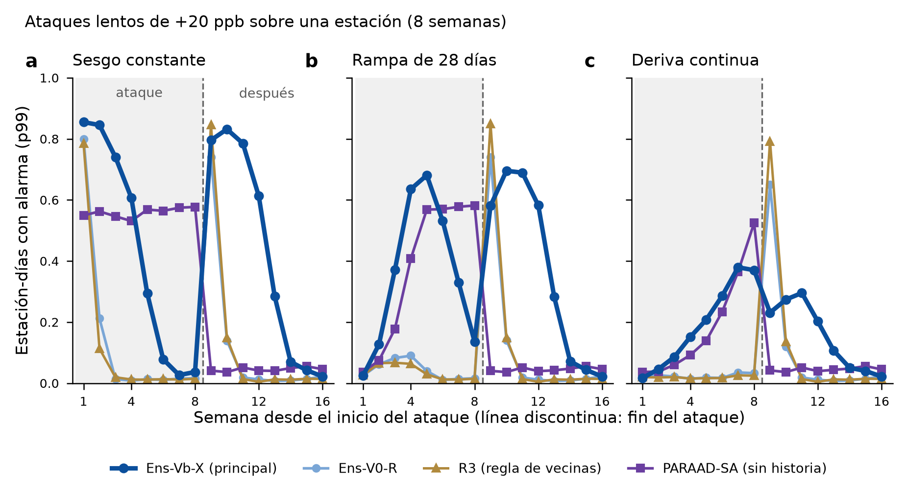

# Resultados de la revisión 23b (D1): sesgo sostenido y deriva lenta

Fecha: 2026-11-08. Registro: [registro_previo_rev23b_ataque_lento.md](registro_previo_rev23b_ataque_lento.md), aprobado, con su enmienda (Ens-Vb-X) y sus precisiones. Describe detectores congelados; no se eligió nada.

**Veredicto en una línea.** Ante un atacante paciente:
- **Ens-Vb-X/Ens-Vb-R detecta ~4 semanas** y luego su mediana de 60 días absorbe el sesgo.
- **V0, L0 y R3 se ciegan en 2 semanas.**
- **PARAAD, sin historia, detecta igual en la semana 1 que en la 8.**
- Con rampas y derivas Vb resiste mucho mejor que V0.
- Al terminar un ataque largo, Vb dispara un **rebote** de alarmas de unas 7 semanas.
- La regla de la revisión 24 no cambia nada aquí, como se predijo.

*Figura.* Fracción de estación-días con alarma (p99, umbral de 2023), por semana desde el inicio de ataques de 8 semanas con A = +20 ppb (240 episodios aislados de sus vecinas, 30 calendarios del banco 2024–jul 2026).
- Dentro del ataque (gris) es el recall; después, falsas alarmas (rebote).
- Ens-Vb-R coincide con Ens-Vb-X (diferencia ≤ 0.004) y L0 único con Ens-V0-R; por eso no se dibujan.

## Qué se corrió
- **Matrices:** 183 por corrida (180 alteradas + 3 años limpios), con dos corridas idénticas (diferencia 0.0, los mismos SHA-256 de contenido).
- **Detectores:** Ens-Vb-X (principal desde la revisión 24), Ens-Vb-R, Ens-V0-R, L0 único, R3 y PARAAD, con la inferencia idéntica bit a bit a la calibración.
- **Comprobaciones:** R3 reproduce la revisión 18 en los años limpios, y el escalón es idéntico a `ar.aplicar_fijo`.
- **Cambio real medio por semana (A = 20):**
  - escalón ≈ 17.8 ppb todas las semanas;
  - rampa 2.4 → 15.7 ppb en las semanas 1–4 y luego 17.9;
  - deriva 1.2 → 16.9 ppb.

## Recall por semana (p99) y rebote
**Escalón +20 ppb**
| Detector | S1 | S2 | S3 | S4 | S5 | S6 | S7 | S8 | Después S1–4 (× limpio) |
|---|---|---|---|---|---|---|---|---|---|
| **Ens-Vb-X** | 0.85 | 0.85 | 0.74 | 0.61 | 0.29 | 0.08 | 0.03 | 0.04 | 58× |
| Ens-Vb-R | 0.86 | 0.85 | 0.74 | 0.61 | 0.29 | 0.08 | 0.03 | 0.04 | 59× |
| Ens-V0-R | 0.80 | 0.21 | 0.01 | 0.01 | 0.01 | 0.01 | 0.01 | 0.02 | 21× |
| L0 único | 0.79 | 0.22 | 0.01 | 0.01 | 0.01 | 0.01 | 0.02 | 0.02 | 20× |
| R3 | 0.78 | 0.11 | 0.02 | 0.01 | 0.01 | 0.01 | 0.01 | 0.01 | 23× |
| PARAAD | 0.55 | 0.56 | 0.55 | 0.53 | 0.57 | 0.56 | 0.57 | 0.58 | 2× |

**Escalón +40 ppb**
| Detector | S1 | S2 | S3 | S4 | S5 | S6 | S7 | S8 | Después S1–4 (× limpio) |
|---|---|---|---|---|---|---|---|---|---|
| **Ens-Vb-X** | 0.98 | 0.96 | 0.92 | 0.87 | 0.57 | 0.13 | 0.05 | 0.06 | 72× |
| Ens-Vb-R | 0.98 | 0.96 | 0.92 | 0.86 | 0.57 | 0.13 | 0.05 | 0.06 | 73× |
| Ens-V0-R | 0.96 | 0.56 | 0.03 | 0.02 | 0.03 | 0.02 | 0.02 | 0.03 | 33× |
| L0 único | 0.93 | 0.56 | 0.04 | 0.03 | 0.03 | 0.02 | 0.02 | 0.04 | 32× |
| R3 | 0.94 | 0.22 | 0.05 | 0.04 | 0.03 | 0.03 | 0.03 | 0.04 | 29× |
| PARAAD | 0.93 | 0.94 | 0.94 | 0.93 | 0.93 | 0.94 | 0.95 | 0.93 | 2× |

**Rampa de 28 días hasta +20 ppb**
| Detector | S1 | S2 | S3 | S4 | S5 | S6 | S7 | S8 | Después S1–4 (× limpio) |
|---|---|---|---|---|---|---|---|---|---|
| **Ens-Vb-X** | 0.02 | 0.13 | 0.37 | 0.64 | 0.68 | 0.53 | 0.33 | 0.14 | 49× |
| Ens-Vb-R | 0.03 | 0.13 | 0.37 | 0.64 | 0.68 | 0.53 | 0.33 | 0.14 | 50× |
| Ens-V0-R | 0.02 | 0.06 | 0.08 | 0.09 | 0.04 | 0.01 | 0.01 | 0.02 | 21× |
| L0 único | 0.02 | 0.07 | 0.09 | 0.09 | 0.04 | 0.01 | 0.02 | 0.02 | 20× |
| R3 | 0.03 | 0.07 | 0.07 | 0.06 | 0.03 | 0.01 | 0.01 | 0.01 | 23× |
| PARAAD | 0.04 | 0.07 | 0.18 | 0.41 | 0.57 | 0.57 | 0.58 | 0.58 | 2× |

**Deriva continua hasta +20 ppb**
| Detector | S1 | S2 | S3 | S4 | S5 | S6 | S7 | S8 | Después S1–4 (× limpio) |
|---|---|---|---|---|---|---|---|---|---|
| **Ens-Vb-X** | 0.02 | 0.05 | 0.09 | 0.15 | 0.21 | 0.29 | 0.38 | 0.37 | 19× |
| Ens-Vb-R | 0.02 | 0.05 | 0.08 | 0.15 | 0.21 | 0.29 | 0.38 | 0.37 | 20× |
| Ens-V0-R | 0.02 | 0.03 | 0.02 | 0.01 | 0.02 | 0.02 | 0.04 | 0.03 | 18× |
| L0 único | 0.02 | 0.03 | 0.02 | 0.02 | 0.02 | 0.01 | 0.04 | 0.03 | 18× |
| R3 | 0.02 | 0.02 | 0.02 | 0.02 | 0.02 | 0.02 | 0.03 | 0.02 | 22× |
| PARAAD | 0.04 | 0.04 | 0.06 | 0.09 | 0.14 | 0.23 | 0.37 | 0.52 | 2× |

**Deriva continua hasta +40 ppb**
| Detector | S1 | S2 | S3 | S4 | S5 | S6 | S7 | S8 | Después S1–4 (× limpio) |
|---|---|---|---|---|---|---|---|---|---|
| **Ens-Vb-X** | 0.02 | 0.13 | 0.36 | 0.63 | 0.78 | 0.82 | 0.87 | 0.86 | 58× |
| Ens-Vb-R | 0.02 | 0.13 | 0.36 | 0.63 | 0.78 | 0.83 | 0.88 | 0.86 | 60× |
| Ens-V0-R | 0.02 | 0.06 | 0.08 | 0.09 | 0.09 | 0.08 | 0.11 | 0.08 | 33× |
| L0 único | 0.02 | 0.07 | 0.09 | 0.09 | 0.09 | 0.08 | 0.12 | 0.10 | 31× |
| R3 | 0.03 | 0.06 | 0.07 | 0.06 | 0.07 | 0.08 | 0.09 | 0.07 | 29× |
| PARAAD | 0.04 | 0.07 | 0.18 | 0.40 | 0.67 | 0.80 | 0.90 | 0.92 | 2× |

La última columna es la tasa de alarmas de la estación en las 4 semanas posteriores al fin, como múltiplo de su tasa en limpio.

## Episodios con al menos una alarma durante sus 8 semanas (p99)
| Detector | Escalón 20 | Escalón 40 | Rampa 20 | Rampa 40 | Deriva 20 | Deriva 40 |
|---|---|---|---|---|---|---|
| **Ens-Vb-X** | 0.98 | 0.98 | 0.96 | 0.98 | 0.82 | 0.99 |
| Ens-Vb-R | 0.97 | 0.98 | 0.96 | 0.98 | 0.82 | 0.99 |
| Ens-V0-R | 0.96 | 0.98 | 0.64 | 0.97 | 0.41 | 0.82 |
| L0 único | 0.95 | 0.97 | 0.63 | 0.95 | 0.42 | 0.82 |
| R3 | 0.96 | 0.99 | 0.66 | 0.96 | 0.40 | 0.80 |
| PARAAD | 0.96 | 1.00 | 0.90 | 1.00 | 0.76 | 0.97 |

## F1 por variante (p99, sólo para comparar detectores dentro de cada columna)
| Detector | Escalón 20 | Escalón 40 | Rampa 20 | Rampa 40 | Deriva 20 | Deriva 40 |
|---|---|---|---|---|---|---|
| **Ens-Vb-X** | 0.41 | 0.47 | 0.36 | 0.53 | 0.24 | 0.49 |
| Ens-Vb-R | 0.42 | 0.47 | 0.36 | 0.54 | 0.24 | 0.50 |
| Ens-V0-R | 0.18 | 0.26 | 0.06 | 0.27 | 0.03 | 0.10 |
| L0 único | 0.18 | 0.26 | 0.06 | 0.26 | 0.04 | 0.11 |
| R3 | 0.17 | 0.22 | 0.05 | 0.25 | 0.03 | 0.09 |
| PARAAD | 0.53 | 0.75 | 0.39 | 0.63 | 0.21 | 0.48 |

## Preguntas declaradas (p99; IC del 95 %, bootstrap estación × mes)
| | Medida | p99 | p99.9 (descriptivo) | Lectura |
|---|---|---|---|---|
| **Q1** | Escalón 20, recall en semanas 5–8, PARAAD − Ens-Vb-R | +0.461 [+0.412, +0.511] | +0.222 [+0.176, +0.268] | PARAAD gana cuando el sesgo ya es viejo |
| **Q2** | Rampa 20, recall en semanas 1–4, Ens-Vb-R − Ens-V0-R | +0.225 [+0.196, +0.255] | +0.104 [+0.086, +0.125] | Vb resiste mejor el arranque lento |
| **Q3** | Escalón 20, tasa de alarmas en 4 semanas posteriores − tasa limpia (Ens-Vb-R) | +0.748 [+0.705, +0.786] | +0.437 [+0.391, +0.482] | Rebote enorme: ~75 % de los días con alarma |
| **Q4** | Deriva 40, recall de las 8 semanas, Ens-Vb-R − PARAAD | +0.065 [+0.031, +0.098] | -0.006 [-0.044, +0.030] | Vb algo mejor con p99; empate con p99.9 |

## Predicciones (registradas antes de generar nada)
| # | Predicción | Valor | ¿Se cumple? |
|---|---|---|---|
| 1 | Vb, escalón 20: semana 1 ≥ 0.7 y semanas 5–8 ≤ 0.3 | 0.86 y 0.11 | ✓ |
| 2 | V0, L0 y R3 ≤ 0.3 en la semana 3 | 0.01, 0.01, 0.02 | ✓ |
| 3 | PARAAD plano (< 0.10) y Q1 > 0 | 0.55 → 0.57; IC > 0 | ✓ |
| 4 | Q2 > 0 | +0.225 [+0.196, +0.255] | ✓ |
| 5 | Rebote de Vb (Q3 > 0, ≥ 3× en las semanas 1–4) y más corto en V0 | 59×; duración 7 frente a 2 semanas | ✓ |
| 6 | Deriva: Vb < 0.3 con A = 20 y PARAAD > Vb con A = 40 | 0.19; pero Vb − PARAAD = +0.065 | ✗ (Vb no pierde contra PARAAD en la deriva) |
| 7 | Ens-Vb-X ≈ Ens-Vb-R (< 0.03 por semana) | 0.004 | ✓ |

## Lectura para la tesis
1. **Tiempo máximo de detección.** Vb detecta un sesgo constante unas 4 semanas (con 20 ppb: 0.86, 0.85, 0.74 y 0.61) y queda ciego desde la semana 6. Es exactamente lo que dura su mediana de 60 días en «rendirse». V0, L0 y R3, con bases de 14 días, duran 1–2 semanas.
2. **El ataque lento sí engaña, pero menos a Vb.**
   - Con una rampa de 4 semanas hasta 20 ppb, V0 casi nunca alarma (≤ 0.09); Vb llega a 0.64–0.68 en las semanas 4–5.
   - Con una deriva hasta 20 ppb en 8 semanas, Vb sólo llega a 0.38. V0 no detecta nada (detecta el 41 % de los episodios en algún momento, frente al 82 % de Vb).
3. **PARAAD es el complemento natural:** no usa historia, así que no se acostumbra. Con 40 ppb detecta 0.93 todas las semanas. Ya lo era contra el ataque coordinado (revisión 23).
4. **El rebote es un riesgo operativo y, a la vez, una huella.** Al terminar un ataque largo, Vb ve la vuelta a la normalidad como una anomalía durante ~7 semanas (~60× su tasa de falsas alarmas). Eso también pasaría tras una recalibración legítima del sensor.
   - Para el operador, una racha de alarmas después de un periodo quieto es una señal de que hubo un sesgo sostenido.
   - Conviene documentarlo como procedimiento: tras mantenimiento o recalibración, reiniciar la base.
5. **La regla de la revisión 24 no estorba ni ayuda aquí,** porque las vecinas están limpias.

## Límites
- **El banco no es virgen:** es descriptivo.
- **Sólo error aditivo:** sin deriva de ganancia.
- **Episodios aislados de sus vecinas:** no se combinó lento con coordinado.
- **Un solo largo (8 semanas) y dos magnitudes.** No hay barrido de duración ni de pendiente.
- **Rebote sólo con A = 20 en Q3;** el resto es descriptivo.

## Salidas
En `results/linea_base/rev23b/`:
- **Tablas:** `por_semana.csv`, `rebote.csv`, `resumen.csv`, `cambio_por_semana.csv` y `pruebas.csv`.
- **Decisiones:** `predicciones.json` y `decision.json`.
- **Comprobaciones:** `validacion.json` y `puntajes_sha256.json`.
- **Planes:** `planes/` (30) y `planes_sha256.json`.

Código: `experiments/linea_base/rev23b.py` y `rev23b_metricas.py`.
