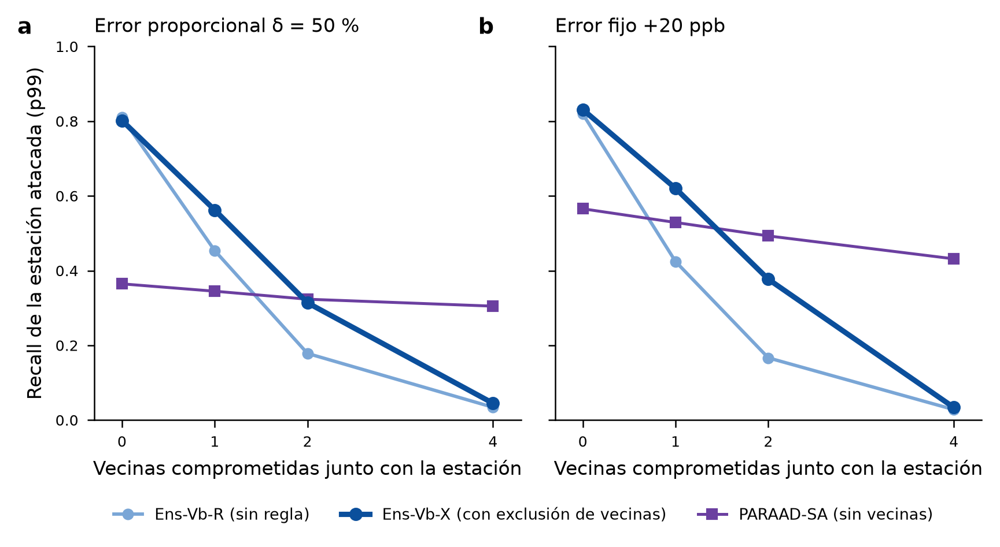

# Resultados de la revisión 24: excluir vecinas sospechosas (Ens-Vb-X)

Fecha: 2026-11-07/08. Registro: [registro_previo_rev24_exclusion_vecinas.md](registro_previo_rev24_exclusion_vecinas.md), aprobado, con sus precisiones y la enmienda 1 (escala de τ).

**Veredicto en una línea.** La regla del tesista funciona y se adopta:
- con 1 o 2 vecinas comprometidas, recupera entre el 21 % y el 58 % del recall perdido (más con error fijo y ataques fuertes; δ 100/50, 20 y 40 ppb);
- con una sola estación atacada no pierde nada;
- en la ventana de despliegue rinde igual que Ens-Vb-R.

Con las 4 vecinas comprometidas no ayuda, como se esperaba. **Ens-Vb-X sustituye a Ens-Vb-R como detector principal** (T1 y T2 pasan).

*Figura.* Recall de la estación atacada con p99 (umbral de 2023), según cuántas de sus vecinas de Vb se alteran junto con ella. Banco 2024–jul 2026, 30 calendarios.
- **a** δ = 50 %.
- **b** +20 ppb.
- «4» es E2-4: todas sus vecinas alterables; tres cuando una de ellas es HGM.

## Qué se hizo
1. **Regla, sin reentrenar.** Si una vecina se aparta de la mediana de las otras igual que la estación evaluada (media de 24 h de la desviación V0, umbral τ), se trata como dato faltante en la base Vb, en a14 y en la ventana. Se excluyen como máximo 2.
2. **Enmienda 1.** La grilla de τ original (1, 1.5, 2 σ) nunca se activaba. Se sustituyó, antes de puntuar ataques, por los cuantiles 95/99/99.9 de 2020–2021 limpio: τ = 0.26, 0.42 y 0.69 σ.
3. **Elección en 2022,** con los modelos de selección: **τ = 0.2596** (cuantil 95).
   - El recall medio de *s* en E2-1/E2-2 pasa de 0.316 a 0.505.
   - El F̄ de E1 queda en 0.402 (frente a 0.403).
   - Los tres τ cumplían la restricción, y se eligió el de mayor recall.
4. **Calibración con 2023 limpio** (9 097 estación-días): umbrales de Ens-Vb-X p99 = 0.1508 y p99.9 = 0.6310. Ens-Vb-R se reprodujo con diferencia 0.0.
5. **Banco:** 723 matrices por corrida, con dos corridas idénticas (diferencia 0.0). Ens-Vb-R y PARAAD coinciden bit a bit con la revisión 23 en E1 y E2-4.
6. **Validaciones:** con τ = ∞, Ens-Vb-X = Ens-Vb-R exactamente. El cálculo incremental es exacto con la regla activa (`validacion.json`).

## Recall de la estación atacada (p99)
| Escenario | Detector | δ 100 | δ 50 | δ 20 | 10 ppb | 20 ppb | 40 ppb |
|---|---|---|---|---|---|---|---|
| E1 (0 vecinas) | Ens-Vb-R | 0.94 | 0.81 | 0.20 | 0.22 | 0.82 | 0.96 |
|  | **Ens-Vb-X** | 0.93 | 0.80 | 0.20 | 0.23 | 0.83 | 0.96 |
|  | PARAAD | 0.68 | 0.36 | 0.09 | 0.10 | 0.57 | 0.92 |
| E2-1 (1 vecina) | Ens-Vb-R | 0.65 | 0.45 | 0.10 | 0.13 | 0.42 | 0.72 |
|  | **Ens-Vb-X** | 0.77 | 0.56 | 0.12 | 0.16 | 0.62 | 0.86 |
|  | PARAAD | 0.67 | 0.34 | 0.09 | 0.10 | 0.53 | 0.91 |
| E2-2 (2 vecinas) | Ens-Vb-R | 0.30 | 0.18 | 0.06 | 0.07 | 0.17 | 0.34 |
|  | **Ens-Vb-X** | 0.52 | 0.31 | 0.08 | 0.10 | 0.38 | 0.63 |
|  | PARAAD | 0.65 | 0.32 | 0.08 | 0.10 | 0.49 | 0.90 |
| E2-4 (todas) | Ens-Vb-R | 0.05 | 0.03 | 0.02 | 0.02 | 0.03 | 0.03 |
|  | **Ens-Vb-X** | 0.07 | 0.05 | 0.02 | 0.03 | 0.03 | 0.04 |
|  | PARAAD | 0.62 | 0.31 | 0.08 | 0.09 | 0.43 | 0.87 |

## Diferencia Ens-Vb-X − Ens-Vb-R en ese recall (IC del 95 %, bootstrap pareado estación × mes)
| Escenario | δ 100 | δ 50 | δ 20 | 10 ppb | 20 ppb | 40 ppb |
|---|---|---|---|---|---|---|
| E1 (0 vecinas) | -0.00 [-0.01, +0.00] | -0.01 [-0.02, +0.00] | +0.00 [-0.00, +0.01] | +0.00 [-0.01, +0.01] | +0.01 [-0.00, +0.03] | -0.00 [-0.01, +0.00] |
| E2-1 (1 vecina) | +0.12 [+0.09, +0.15] | +0.11 [+0.08, +0.14] | +0.02 [+0.01, +0.03] | +0.03 [+0.02, +0.04] | +0.20 [+0.16, +0.23] | +0.14 [+0.11, +0.17] |
| E2-2 (2 vecinas) | +0.22 [+0.18, +0.25] | +0.14 [+0.11, +0.16] | +0.02 [+0.01, +0.04] | +0.03 [+0.02, +0.05] | +0.21 [+0.18, +0.25] | +0.29 [+0.25, +0.33] |
| E2-4 (todas) | +0.02 [+0.01, +0.03] | +0.01 [+0.00, +0.02] | +0.00 [-0.00, +0.01] | +0.00 [-0.00, +0.01] | +0.01 [-0.00, +0.01] | +0.01 [-0.00, +0.01] |

## Pruebas registradas (p99)
- **T1, no daña:** en E1, ΔF̄ = -0.006 [-0.015, +0.002]. El límite inferior es > −0.02, así que **pasa**. Con p99.9: +0.001 [-0.006, +0.007].
- **T2, evita perder:** en E2-1 con δ = 50 %, Δrecall de *s* = +0.109 [+0.082, +0.136]. El IC es > 0, así que **pasa**. Con p99.9: +0.082 [+0.060, +0.105].
- **Adopción:** Ens-Vb-X sustituye a Ens-Vb-R.

## Más resultados (descriptivos)
**F̄ dentro de cada escenario (X − R):**
| Escenario | ΔF̄ (δ) p99 | ΔF̄ppb p99 | ΔF̄ (δ) p99.9 | ΔF̄ppb p99.9 |
|---|---|---|---|---|
| E1 (0 vecinas) | -0.006 [-0.015, +0.002] | -0.002 [-0.012, +0.007] | +0.001 [-0.006, +0.007] | -0.000 [-0.008, +0.007] |
| E2-1 (1 vecina) | +0.018 [+0.008, +0.027] | +0.033 [+0.023, +0.042] | +0.052 [+0.039, +0.063] | +0.072 [+0.058, +0.085] |
| E2-2 (2 vecinas) | +0.031 [+0.022, +0.039] | +0.050 [+0.040, +0.060] | +0.037 [+0.027, +0.048] | +0.062 [+0.049, +0.074] |
| E2-4 (todas) | +0.031 [+0.025, +0.039] | +0.048 [+0.040, +0.056] | +0.041 [+0.032, +0.049] | +0.053 [+0.044, +0.063] |

**Detección del ataque, con al menos una alarma en el grupo (p99):**
- Ens-Vb-X: 0.88/0.89 en E2-1, 0.87/0.89 en E2-2 y 0.82/0.86 en E2-4 (δ50 / 20 ppb).
- Ens-Vb-R: 0.85/0.83, 0.82/0.81 y 0.75/0.74.
- PARAAD: 0.57/0.74, 0.58/0.77 y 0.62/0.79.

**Falsas alarmas en limpio (2024–jul 2026, 23 005 estación-días):**
- p99: Ens-Vb-X 1.30 %, Ens-Vb-R 1.28 %.
- p99.9: 0.18 % los dos.
- La precisión en E1 baja 0.005.

**Ventana de despliegue ago–sep 2026** (descriptivo, la misma tubería de la revisión 22):
- ΔF̄ (X − R) = -0.0005 [-0.0072, +0.0071] con p99, y +0.0030 [-0.0084, +0.0147] con p99.9.
- Ens-Vb-X con p99: F̄ 0.635, F1 δ100 0.799, δ50 0.792.
- Ens-Vb-X con p99.9: F1 δ100 0.837.
- La ventaja ganada en el despliegue se conserva. Ens-Vb-R de esta tubería coincide con el examen de la revisión 22 (diferencia 2.2e-16, sólo orden de suma).

## Predicciones (registradas antes de generar nada)
| # | Predicción | Valor | ¿Se cumple? |
|---|---|---|---|
| 1 | T1 pasa | IC [−0.015, +0.002] | ✓ |
| 2 | T2 pasa y el recall de *s* en E2-1 (δ50) llega a ≥ 0.65 | 0.45 → 0.56 | ✗ (T2 pasa, pero la ganancia es menor) |
| 3 | En E2-2 (δ50) llega a ≥ 0.45 | 0.18 → 0.31 | ✗ (sube, pero menos) |
| 4 | En E2-4 no cambia (< 0.03) | 0.034 → 0.045 | ✓ |
| 5 | La precisión en E1 baja ≤ 0.02 | −0.005 | ✓ |
| 6 | Con error fijo, la ganancia en E2-1 es parecida (±0.10) | +0.20 (20 ppb) frente a +0.11 (δ50) | ✓ |

## Lectura para la tesis
- **Modelo de amenaza.** Con la regla, el atacante necesita comprometer **3 o más** vecinas además de la estación para cegar al detector (antes bastaban 1–2 para bajar mucho el recall). El costo sube; no es infalible.
- **Recuperación parcial, no total:**
  - con 1 vecina comprometida y 40 ppb, el recall vuelve a 0.86 (sin vecinas era 0.96, sin regla 0.72);
  - con 2 vecinas, de 0.34 a 0.63.
- **Con todas las vecinas comprometidas sólo ayuda un detector sin vecinas** (PARAAD conserva 0.31–0.87). La combinación de los dos queda como trabajo futuro, sin registrar.

## Límites
- **Enmienda 1:** la grilla de τ se corrigió después de aprobado el registro, pero antes de puntuar ataques y sólo con datos limpios de 2020–2021.
- **El banco no es virgen:** es donde se descubrió la debilidad. τ se eligió en 2022.
- **Escenarios con «2 vecinas»:** usan dos vecinas al azar entre las de Vb. Un atacante que elija las que más pesan podría hacer más daño.
- **El despliegue es descriptivo:** dos meses de datos crudos de SINAICA.

## Salidas
En `results/linea_base/rev24/`:
- **Elección de τ:** `grilla_tau.json`, `diseno_2022.csv` y `decision_tau.json`.
- **Calibración:** `umbrales_2023_X.json`.
- **Banco:** `metricas_banco.csv`, `pruebas_banco.csv`, `falsas_alarmas_banco.csv`, `predicciones.json` y `decision_adopcion.json`.
- **Despliegue:** `despliegue_2026.csv` y `despliegue_2026.json`.
- **Validación y modelos:** `validacion.json` y `modelos_seleccion_sha256.json`.
- **Planes:** `planes/` y `planes_sha256.json`.

Código: `experiments/linea_base/rev24.py` (motor y etapas) y `rev24_metricas.py`.
