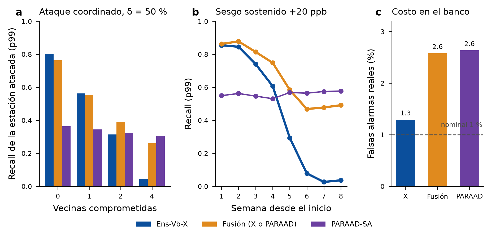

# Resultados de la revisión 25: fusión Ens-Vb-X + PARAAD (retador)

Fecha: 2026-11-08. Registro: [registro_previo_rev25_fusion_paraad.md](registro_previo_rev25_fusion_paraad.md).

**Veredicto en una línea (clasificación registrada): «compromiso».**
- Ens-Vb-X sigue siendo el mejor en el caso normal (un nodo alterado).
- La fusión cubre los dos huecos: vecindario comprometido y sesgo de más de un mes.
- Pero en el banco duplica las falsas alarmas reales, por la mala transferencia de los umbrales de PARAAD. Por eso pierde en F̄.
- En la ventana de despliegue, donde PARAAD sí estaba bien calibrado, la fusión empata o gana un poco.

*Figura.*
- **a** Recall de la estación atacada (p99) según cuántas vecinas se comprometen (banco, δ 50 %).
- **b** Recall por semana ante un sesgo sostenido de +20 ppb (D1).
- **c** Falsas alarmas reales en el banco limpio 2024–jul 2026 (23 005 estación-días) con el presupuesto nominal de 1 % fijado en 2023.

## Calibración en 2023 limpio (9 097 estación-días)
- **p99:** *q* = 0.00517 por detector. Umbrales: X 0.2731 (antes 0.1508) y PARAAD 0.6971 (antes 0.6405). Tasa combinada en 2023: 0.98 %.
- **p99.9:** *q* = 0.000549. Umbrales: X 0.7012 y PARAAD 0.8477. Tasa combinada: 0.088 %.
- **PARAAD en 2023** se recalculó con las mismas funciones: diferencia 1.4e-6 con la revisión 20.

## Pruebas registradas (p99)
| | Medida | Resultado | ¿Pasa? |
|---|---|---|---|
| **T1, no daña demasiado** | E1, ΔF̄ Fusión − X | -0.110 [-0.157, -0.071] | ✗ (límite −0.02) |
| **T2, cubre el coordinado** | E2-4, δ50, Δrecall de *s* | +0.217 [+0.183, +0.252] | ✓ |
| **T3, cubre el lento** | D1, escalón 20 ppb, semanas 5–8 | +0.396 [+0.351, +0.443] | ✓ |

Con p99.9 (descriptivo): T1 -0.106 [-0.156, -0.058], T2 +0.155 [+0.126, +0.185] y T3 +0.234 [+0.192, +0.278].

## Por qué falla T1: falsas alarmas, no detección
- **Con una sola estación atacada la fusión detecta casi lo mismo:** recall de *s* con δ50 de 0.80 → 0.76, y con 20 ppb de 0.83 → 0.84. Pero la precisión cae (δ50: 0.31 → 0.18).
- **La razón:** en el banco, los umbrales de PARAAD fijados en 2023 dan **2.6 %** de falsas alarmas en lugar de 1 %. La fusión los hereda: **2.6 %** frente a 1.3 % de Ens-Vb-X. Con p99.9: 0.84 % frente a 0.18 %.

| Escenario | Tamaño | Recall de *s*: X / Fusión | Precisión: X / Fusión | F1: X / Fusión |
|---|---|---|---|---|
| E1 | δ 50 % | 0.80 / 0.76 | 0.31 / 0.18 | 0.44 / 0.30 |
| E1 | +20 ppb | 0.83 / 0.84 | 0.32 / 0.20 | 0.46 / 0.32 |
| E2-1 | δ 50 % | 0.56 / 0.55 | 0.38 / 0.26 | 0.46 / 0.36 |
| E2-1 | +20 ppb | 0.62 / 0.68 | 0.39 / 0.29 | 0.48 / 0.41 |
| E2-2 | δ 50 % | 0.31 / 0.39 | 0.39 / 0.30 | 0.43 / 0.38 |
| E2-2 | +20 ppb | 0.38 / 0.54 | 0.41 / 0.35 | 0.46 / 0.45 |
| E2-4 | δ 50 % | 0.05 / 0.26 | 0.36 / 0.34 | 0.32 / 0.37 |
| E2-4 | +20 ppb | 0.03 / 0.34 | 0.38 / 0.39 | 0.35 / 0.43 |

## Lo que cubre la fusión
- **Coordinado:**
  - con todas las vecinas comprometidas, el recall de *s* pasa de 0.05 a 0.26 (δ50) y de 0.03 a 0.34 (20 ppb);
  - con 2 vecinas, de 0.31 a 0.39 (δ50) y de 0.38 a 0.54 (20 ppb);
  - el F̄ dentro de E2-4 sube +0.054 [+0.035, +0.073].
- **Lento (escalón de 20 ppb):** semanas 1–4: 0.86, 0.88, 0.81, 0.75 (X: 0.85, 0.85, 0.74, 0.61). Semanas 5–8: 0.58, 0.47, 0.48, 0.49 (X: 0.29, 0.08, 0.03, 0.04).
- **Rebote tras el fin:** sigue ahí, porque lo produce la parte de X (0.73–0.78 en las semanas 1–3 posteriores).

## Ventana de despliegue ago–sep 2026 (descriptivo)
- **F̄ p99:** Fusión 0.645 frente a X 0.635; ΔF̄ +0.010 [-0.027, +0.052]. F1 δ100: 0.863 frente a 0.799.
- **p99.9:** ΔF̄ +0.011 [-0.008, +0.034].
- **Falsas alarmas en limpio con p99:** fusión 0.1 % y X 0.2 %. En esta ventana PARAAD estaba bien calibrado.

## Predicciones (registradas antes de calcular)
| # | Predicción | Valor | ¿Se cumple? |
|---|---|---|---|
| 1 | T1 falla por poco (ΔF̄ entre −0.04 y −0.01) | −0.110 | ✗ (falla por mucho) |
| 2 | T2 pasa y el recall de *s* en E2-4 llega a ≥ 0.20 | 0.05 → 0.26 | ✓ |
| 3 | T3 pasa y las semanas 5–8 llegan a ≥ 0.40 | 0.11 → 0.51 | ✓ |
| 4 | Falsas alarmas reales de la fusión entre 1.6 y 2.2 % | 2.6 % | ✗ (peor) |
| 5 | En el despliegue la fusión queda por debajo de X | +0.010 | ✗ (empata o gana un poco) |
| 6 | Veredicto «compromiso» | compromiso | ✓ |

## Lectura para la tesis
1. **¿Ens-Vb-X es el mejor?** Sí, para la amenaza principal (un nodo) y con el presupuesto de falsas alarmas que pide el operador. La fusión no lo supera en el banco.
2. **Ningún detector solo cubre las tres amenazas.** La fusión lo logra a cambio de duplicar las falsas alarmas mientras PARAAD esté mal calibrado. Es un **modo de alta cobertura** que el operador puede activar si teme ataques coordinados o persistentes.
3. **El cuello de botella es la calibración de PARAAD, no su capacidad.** Donde PARAAD está bien calibrado (el despliegue), la fusión no pierde. Recalibrar periódicamente el umbral de PARAAD con datos limpios recientes podría convertir el «compromiso» en «mejor en general». Queda como trabajo futuro y necesitaría un examen nuevo.

## Límites
- **El banco y D1 no son vírgenes,** y el desempeño de cada detector por separado ya se conocía.
- **El reparto del presupuesto es fijo** (la misma *q*) y no se optimizó.
- **La parte de PARAAD decide por día completo:** no da alerta temprana por hora.
- **Supervisión distinta** entre los dos detectores.

## Salidas
En `results/linea_base/rev25/`:
- **Calibración:** `paraad_2023.npz` y `umbrales_fusion_2023.json`.
- **Métricas:** `metricas_banco.csv`, `falsas_alarmas_banco.csv`, `d1_por_semana.csv` y `despliegue_2026.csv`.
- **Pruebas y veredicto:** `pruebas.csv`, `predicciones.json` y `veredicto.json`.

Código: `experiments/linea_base/rev25.py`.
