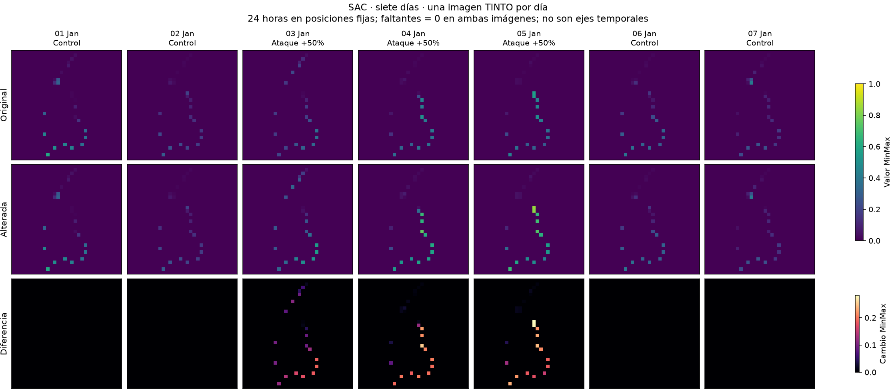
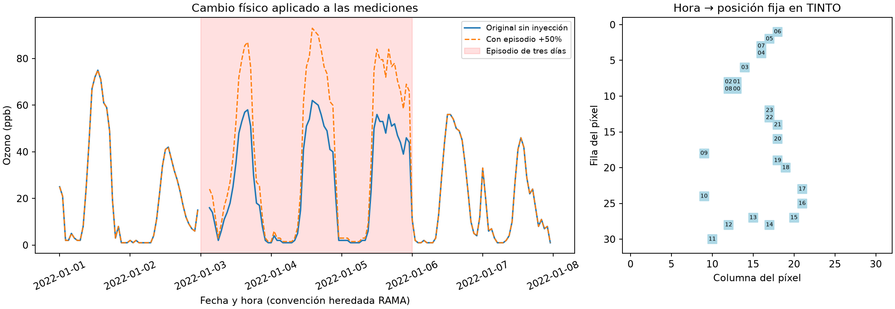
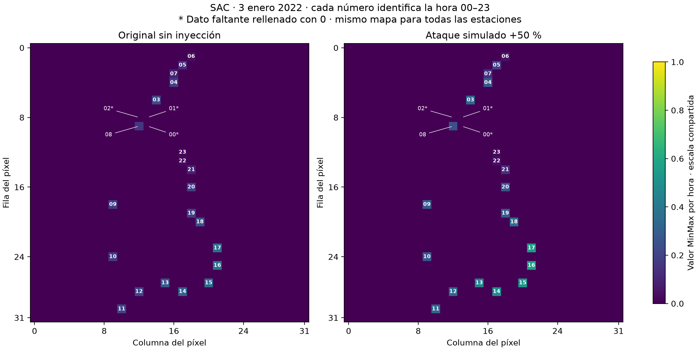
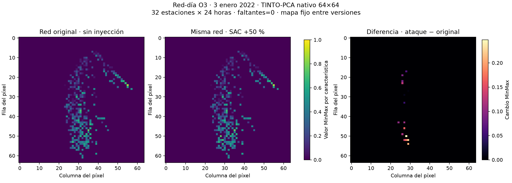

# TINTO — documento general y traspaso a la PC principal

Actualización: 9 de noviembre de 2026. Este documento permite continuar sin el chat.
**Entrada recomendada para el siguiente asistente: leer este archivo completo y
`experiments/tinto_raw/protocolo.md` antes de ejecutar.**

## 1. Qué se está investigando y decisión vigente

Tesis sobre detección de anomalías en ozono de la red RAMA. TINTO transforma una
tabla numérica en imágenes; no detecta ataques por sí mismo. Una CNN posterior
aprende a clasificarlas. El tesista y su tutor solicitaron reiniciar con **O3 crudo
en ppb**, sin las características de L0. Se decidió continuar **supervisado y con
imágenes estación-día**. La alternativa autoencoder se explicó, pero NO se adoptó
ni se ejecutó. No está autorizado cambiar a no supervisado por iniciativa propia.

La última actividad ejecutada es un piloto CNN pequeño de cinco épocas. La
ampliación con calendarios L0 y calibración por percentiles está PROPUESTA, no
implementada ni ejecutada. No hay entrenamiento remoto que continuar ni monitor
TINTO activo de este chat al cierre documentado.

## 2. Dos líneas diferentes que no deben mezclarse

### Historia: TINTO con características de L0 (octubre)

Entrada estación local con cuatro vecinas, ventana24h:17 características porhora,
408 valores (relativas al perfil causal, disponibilidad, comparación vecinal,
seno/coseno). No eran ppb crudos. PCA nativo producía colisiones, por lo que varias
variantes usaron asignación propia de coste mínimo a píxeles únicos. Esa
modificación no debe describirse como rasterización TINTO nativa.

| Experimento | Representación/modelo | Estado y resultado exploratorio |
|---|---|---|
| T1 | Ventana local24h → CNN32×32, asignación única | Cierre manual, checkpoint época5; mediaF1p99≈0.3083 frente a L0≈0.3550 |
| T2 EH/ED/RH/RD | Estación-hora/día y red-hora/día, CNN | ED mejor de estas variantes, mediaF1p99≈0.3224; no superó L0 |
| B12 | Dos imágenes12h, CNN y agregación diaria | Dos corridas reproducibles; mediaF1p99≈0.3096 |
| S12 | Dos imágenes12h, CNN–LSTM con salida diaria | Dos corridas reproducibles; mediaF1p99≈0.3299 |
| S1 | 24 imágenes de una hora, CNN–LSTM | INCOMPLETO: sesión Colab desapareció; primera corrida rescatada, segunda no recuperada. No F1 final validado |

Referencias: `experiments/exploracion_tinto/resultados_t2_granularidad.md`,
`resultados_b12_20261030.md`, `resultados_s12_20261031.md`,
`protocolo_temporal_20261030.md` y
`results/exploracion_tinto_2022/s1_20261031/reintento1/incidente_20261104.md`.
L0/TINTO histórico reutilizaron2022 para selección/calibración/evaluación: números
exploratorios, no prueba independiente. No comparar esosF1 con el piloto raw50/50.
Las imágenes históricas solicitadas están en
`results/exploracion_tinto_2022/galeria_20261105/`.

### Línea activa: TINTO raw (noviembre)

Código: `experiments/tinto_raw/`. Resultados: `results/tinto_raw_20261109/`.
No reutilizar como entrada las matrices de características históricas. Reutilizar
mapas antiguos de408 características tampoco sería válido para las24 lecturas.

## 3. Fuente, fechas y faltantes

Solo O3: originales `data/raw/20RAMA.zip`, `21RAMA.zip`, `22RAMA.zip`, con XLS
internos2020O3.xls/2021O3.xls/2022O3.xls. El lector verifica hashes contra
`docs/checksums_2020_2026.txt`. Se extrajo una tabla de mediciones originales:
`results/tinto_raw_20261109/auditoria1/o3_raw_ppb.csv`. Se incluye para continuar
las representaciones sin necesitar copiar inmediatamente los ZIP originales.

Los ZIP raw están ignorados por Git: **un git pull NO los descarga**. Copiarlos
por separado a data/raw si se quiere repetir la ingesta desde la fuente. No hace
falta copiar años2023–2026 para continuar esta exploración. La tabla exportada
mantiene NaN y todas las estaciones originales; la selección de columnas se hace
explícitamente en cada experimento. Dos extracciones idénticas, valores re-leídos
comprobados exactamente contra los XLS.

| Etapa común con L0 | Periodo | Uso actual |
|---|---|---|
| Ajuste inicial |2020–2021|Mapas, escaladores y piloto CNN|
| Validación exploratoria |2022|Ejemplos y validación piloto|
| Ajuste definitivo futuro |2020–2022|No ejecutado para raw|
| Calibración futura |2023|No abierto para raw|
| Exámenes históricos |2024–2026|No abiertos para raw; ya usados por otras líneas|

RAMA usa-99 como ausencia. En la auditoría se convirtió en NaN, no en medición.
El tesista autorizó comparar relleno0 y99; finalmente los ejemplos incompletos
usan0 idéntico en original y alterado. No introducir máscaras como entrada.
La disponibilidad puede guardarse afuera para auditoría y elegibilidad. No afirmar
que PCA identifica por sí mismo el faltante: una medición real0/99 queda
indistinguible del mismo valor usado para rellenar.

Convención horaria HEREDADA del lector: HORA1→00:00, HORA24→23:00. Su
interpretación contra SIMAT figura como supuesto pendiente en src/ingest/rama.py;
no presentarla como validación nueva. Las tablas anotadas preservan HORA original.

No hay hora completa en las32 estaciones históricas simultáneamente2020–2022.
Sí hay días individuales completos. SAC:204 en2020,224 en2021,220 en2022.
El piloto CNN usa exclusivamente días completos; no demuestra desempeño con huecos.

## 4. Cómo se generan las imágenes activas

TINTOlib1.3.1, PCA, semilla42, blur=False, zoom1, salida numérica. **Mapa nativo**,
sin asignación única propia en esta nueva línea. Escalado MinMax por columna,
ajustado solo con2020–2021, sin recortar valores fuera de[0,1]. Etiqueta ficticia
constante requerida por API excluida de PCA; nunca una etiqueta de ataque de entrada.

Estación-día:24 columnas h00..h23. Un mapa compartido entre31 objetivos
(históricos sinHGM/XAL), una imagen32×32 por estación y día. No se pasa nombre,
fecha, hora seno/coseno, coordenadas, vecinas ni perfiles como características.
La posición de columna conserva implícitamente la identidad de la hora.
Mapa: `representacion1/completos_32_mapa.csv`; escala:
`representacion1/completos_escala.csv` dentro de la raíz de resultados raw.

PCA produce coordenadas y TINTO las rasteriza. Ejes de imagen=columna/fila de
píxel, NO estación/hora ni mapa geográfico. El mapa queda fijo entre días y
estaciones. El color cambia según medición; mismo color entre distintas horas no
necesariamente equivale a los mismosppb porque el escalado es porcolumna.
Los números y textos de las figuras son anotaciones humanas: CNN recibe float32,
no PNG con etiquetas/colores. Los 24 valores se conservan sin colisión en este mapa.

## 5. Experimentos raw ejecutados

### Representación y relleno, dos ejecuciones idénticas

| Entrada | Lado | Posiciones distintas/24 | Cambios individuales+1ppb ocultos |
|---|---:|---:|---:|
| Días completos |32|24|0|
| Días completos |64|23|1|
| Relleno0 |32|24|0|
| Relleno0 |64|24|0|
| Relleno99 |32|20|4|
| Relleno99 |64|23|1|

TINTO sinblur usa última escritura en las colisiones, comprobado con transform.
Mayor resolución no garantiza reducción monótona por redondeo. Control completo
ajusta12146 días; rellenos22661. Cambian muestra y escala, no se atribuye todo al
valor de relleno. No se eligió imputación por desempeño de un detector.
Informe: `informe_representacion.md`.

### Episodio pareado en ppb e imágenes

Primera semana de enero2022 enSAC; ataque+50% días3–5 sobre valores observados.
Se intentó primero la regla de siete días completos consecutivos; no había caso
SAC2022 y se registró alternativa primera semana con0 antes de visualizar.
Tres faltantes: 69 mediciones modificadas y69 cambios de píxel, cero cambios
perdidos, error inverso máximo≈1.42e-14ppb. Fuera del episodio imágenes idénticas.
No se reajustó mapa/escala. Dos ejecuciones idénticas. La diferencia usa original
conocido: diagnóstico controlado, no información disponible al detector real.
Informe: `informe_episodio.md`.





Comparación individual del03enero:21 observaciones y3 valores-99 originales
(HORA1,2,3), rellenados0. No confundirlos con ceros reales. Se generaron también
CCA yPED, fecha prefijada, ataque+50% independiente en cada ejemplo, mismo mapa.
`horas_estaciones/` contiene PNG anotados y CSV hora/píxel/ppb.



### Red-día y pérdida de información

32 estaciones incluyendoHGM, excluyendoXAL, ×24h=768 columnas. Mapas y escalas
propios ajustados con731 días2020–2021, relleno0. Ejemplo03enero2022: soloSAC+50%.

| Lado | Posiciones únicas/768 | Sobrescritas | Cambios SAC visibles/21 |
|---|---:|---:|---:|
|32|240|528|4|
|64|475|293|16|

Cinco cambios desaparecen incluso del tensor64, no solo visualmente. Dos corridas
finales idénticas en `red_dia_final1/2`; `red_dia1/2` son intentos con fallo al
serializar int64 en JSON, no nuevos resultados científicos. No usarlos para seguir.
Mayor resolución y asignación única son alternativas propuestas, NO ejecutadas
para resolver este nuevo mapa. Prioridad elegida por usuario: estación-día.



## 6. Piloto CNN supervisado ya ejecutado

Registro previo en protocolo.md. CPU; CNN compartida34081parámetros:
Conv8(3,same,relu)→Pool2→Conv16→Pool2→Flatten→Dense32relu→Dropout.2→sigmoide.
Adam.001, BCE, batch64, cinco épocas fijas, modelo final época5. Semilla42 justo
antes de construir y de fit, determinismo. No selección por métricas ni continuación
para mejorar resultado. Imágenes generadas desde mapa congelado, sin fitTINTO nuevo.

-1024 bases completas2020–2021, muestreadas sin reemplazo: original+alterada=2048 imágenes.
-256 bases completas2022: original+alterada=512 imágenes.
-Signo sorteado porbase: x*1.5 o x/1.5; etiqueta externa0/1;50%positivos.
-Duración1día permitida; NO calendarios L0, NO prevalencia operativa.
-Bases originales/copia permanecen en misma partición; años separados.

| Medida | Resultado |
|---|---:|
|Entrenamiento5épocasCPU|2.19–2.29s, sin importar TensorFlow|
|Inferencia512imágenes|≈0.07s|
|Tensores de imágenes|10MiB|
|RSS proceso completo|≈940–945MiB, incluido runtime|
|Pérdida validación época1→5|0.6916→0.6498|
|Umbral de clasificación|0.5 fijo, **no percentil**|
|TP/FP/FN/TN|84/41/172/215|
|Recall|0.328125|
|Precisión|0.672|
|F1|0.440945|
|ROC-AUC|0.674225|
|Average precision|0.691942|

Control todo-positivo daF1=0.666667 por el balance50/50, por lo queF1piloto NO es
éxito. ROC-AUC constante0.5 y APprior0.5. La pérdida baja y hay separación parcial,
pero pierde172/256alteraciones al umbral fijo. No comparable con L0p99. No IC.
Dos corridas con pesos/historias/probabilidades exactas: `piloto_cnn1/2/`,
modelos `modelo_final.keras`, `pesos.npz`, manifiestos y probabilidades guardados.
Informe: `informe_piloto_cnn.md`; comprobación: `reproducibilidad_piloto_cnn.json`.

Conclusión limitada: número de imágenes manejable para este piloto, no evidencia
de recall suficiente. Conservación de información NO equivale a recall del modelo.

## 7. Cómo continuar desde otra PC

1. Clonar/actualizar `git@github.com:JoseLili/lorawan11-rama-detection.git`, rama main.
   Leer este documento, el protocolo raw y la fuente general
   `docs/protocolo_anomalias_red_v1.md` (revisiones posteriores a L0 incluidas).
2. Los resultados raw, mapas, tablas y modelos pequeños de este traspaso van enGit.
   No dependen de/tmp ni de una sesiónColab. Los ZIP originales están excluidos;
   copiarlos por separado para volver a auditar fuente. Los paquetes/cachés grandes
   históricos también están excluidos según.gitignore y deben regenerarse.
3. Crear entorno aislado; no sustituir dependencias de los modelos históricos.
   Versiones exactas observadas en `experiments/tinto_raw/entorno_piloto.txt`.
   TensorFlow/Keras son versiones preliminares; otro hardware/versión puede cambiar
   números. No asumir reproducibilidad bit a bit entre equipos. Verificar primero
   que se cargan artefactos; si no están disponibles las versiones, registrar entorno
   nuevo y ejecutar ambas réplicas antes de comparar. TINTOlib1.3.1 debe estar
   instalado en el entorno usado; los scripts no requieren la antigua ruta/tmp.
4. Desde la raíz del repo, con el Python del entorno activo, comandos:

```bash
# Repite ingesta SOLO si copiaste los tres ZIP raw originales:
python experiments/tinto_raw/auditar.py --salida results/tinto_raw_pc/auditoria1
# Estos leen la tabla auditada y mapas incluidos en results/tinto_raw_20261109:
python experiments/tinto_raw/representar.py --salida results/tinto_raw_pc/representacion1
python experiments/tinto_raw/red_dia.py --salida results/tinto_raw_pc/red_dia1
python experiments/tinto_raw/episodio_visual.py --salida results/tinto_raw_pc/episodio1
python experiments/tinto_raw/piloto_cnn.py --salida results/tinto_raw_pc/piloto1
python experiments/tinto_raw/piloto_cnn.py --salida results/tinto_raw_pc/piloto2
```

Las rutas fuente congeladas están explícitas en los scripts; cambiar salida no
cambia el mapa de entrada. Usar carpetas nuevas para no sobrescribir evidencias.
`horas_estaciones.py` y `comparacion_par.py` regeneran figuras en sus rutas fijas;
no ejecutarlos inadvertidamente si se desea conservar los PNG versionados.

## 8. Siguiente experimento propuesto, todavía pendiente

Mantener estación-día supervisado. Ampliar con2020–2021 y calendarios históricosL0,
entrenamiento d50, validación exploratoria2022 con d100/d50/d20 y controles sin
inyección. Antes de programar/entrenar dejar cerrado:

1. Cohorte, mínimos de observación/día y relleno0. El piloto solo vio días completos;
   ampliar a incompletos es un cambio explícito. No máscara de ataque como entrada.
2. Etiqueta diaria y uso de episodios de planes L0. No copiar etiqueta de última
   hora de L0 si se predice todo el día. Mismo soporte al comparar detectores.
3. Muestra/calendarios y prevalencia, manifestados. No usar pares50/50 del piloto
   como sustituto silencioso del escenario operativo.
4. Máximo de épocas/paciencia/min_delta, selección por pérdida2022 y dos réplicas.
5. Calibración exploratoria con2022original, p99principal/p99.9secundario, regla
   estricta `score > umbral`; reutilizar función histórica, no percentil interpolado
   improvisado. Reportar FA observada, recall, precisión,F1 y controles sin inyección.
   Declara reutilización2022; aún no abrir2023–2026.
6. Presupuesto/CPU oGPU, entorno, respaldo por corrida. GPU previamente permitida
   por usuario paraTINTO, pero cambios de entorno no garantizan igualdad. Si se
   vuelve aColab, **CLI autenticado, nunca navegador**. No crear sesiones hasta
   tener concreto paquete/configuración; descargar y verificar antes de cerrar.

No está demostrado que conservar24píxeles garantice detección. No se ha elegido
nuevo modelo definitivo, umbral operativo o reemplazo deL0. No reanudarS1histórico
ni otros experimentos automáticamente. No modificar resultados V4/L0 aceptados.

## 9. Instrucción lista para pegar en otro chat

> Estamos continuando los experimentos TINTO de tesis. Lee docs/traspaso_tinto.md
> y experiments/tinto_raw/protocolo.md y verifica los artefactos incluidos antes
> de actuar. Línea vigente: O3 raw, imagen estación-día, CNN supervisada compartida.
> Piloto cinco épocas ya hecho; el entrenamiento ampliado con calendariosL0 está
> pendiente de concretar. Preserva resultados y no abras años de examen. Quiero
> continuar desde la sección8, sin depender del chat anterior.
