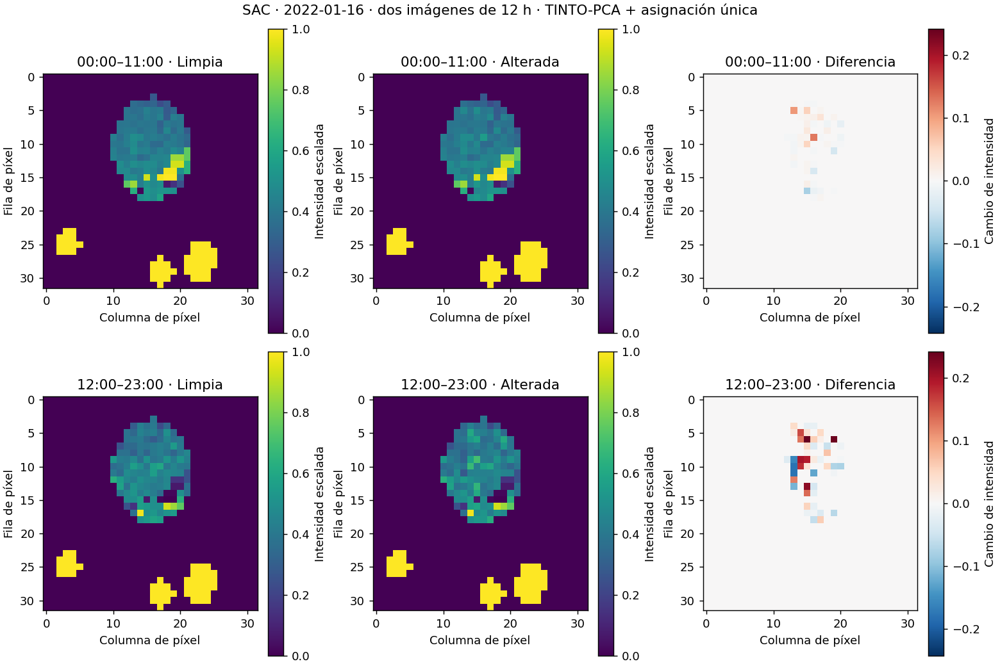

# S12 — cierre exploratorio CNN–LSTM de dos imágenes

Fecha local: 2026-10-31. Paso4 COMPLETADO. Dos modelos recién entrenados desde
cero en Colab L4, TF2.21.0/Keras3.13.2, con configuración previa §13 del protocolo.
No se entrenó S1 ni se abrieron años de examen.

## Integridad y reproducción

Ambas corridas completaron16 épocas, seleccionaron época8 por val_loss
0.023421496152877808, con paciencia8 completa. Duración incluyendo inferencia:
10.8896 y10.9098 minutos. Pesos internos HDF5, historias y31 matrices de scores
idénticos, comprobados nuevamente en local. Dos semillas iguales comprueban
reproducción, no incertidumbre entre semillas. Modelos históricos B12/ED/L0
se comparan usando puntajes guardados, sin reentrenarlos.

TAR final4335704 bytes, SHA256
`0403880eddd361d7e6cfb74be1d02afe4a6fda94f6618d60515df35dd646d289`.
Descargado y verificado antes de liberar exclusivamente tinto-s12-20261031.
Artefactos en `results/exploracion_tinto_2022/s12_20261031/`: respaldos,
resultados_descargados, reproducibilidad_local.json y evaluacion.

## Resultado principal

F1 por estación-día con umbral propio p99 de limpio2022, mismo soporte9661
estación-días y10 calendarios. Promedio simple de F1 entre tres intensidades;
no porcentaje de imágenes clasificadas correctamente.

| Detector | F1 d100 | F1 d50 | F1 d20 | Media F1 p99 |
|---|---:|---:|---:|---:|
| S12: dos bloques CNN–LSTM |0.4411|0.4437|0.1051|0.3299|
| B12: dos bloques CNN + promedio |0.4366|0.4083|0.0838|0.3096|
| ED: una imagen diaria CNN |0.4460|0.4120|0.1092|0.3224|
| L0: LSTM histórica |0.4519|0.4663|0.1467|0.3550|

S12 mejora descriptivamente la media frente B12 en0.0203906 y frente ED
en0.0075760, pero queda0.0250018 por debajo de L0. No cumple la regla previa
L0+0.02=0.3749505 en ninguna corrida. No se sustituye por otro umbral tras ver
los resultados. Comparaciones por intensidad muestran que tampoco supera ED
en todos los escenarios. Intervalos pareados por estación-mes contra L0, ED y
B12 están en evaluacion/intervalos_F1_contra_L0_ED_B12.csv; no se presenta la
diferencia de medias como una prueba de significancia global.

Secundario p99.9, S12 d100/d50/d20:0.6054/0.3502/0.0113. Supera puntualmente
L0 en d100 y d50 en ese umbral, pero no cambia el resultado del criterio principal.
Tablas completas guardan precisión, recall, falsas alarmas, AP y bootstrap.

## Interpretación y límites

Es evidencia favorable al conjunto CNN–LSTM/supervisión diaria frente B12 en
esta exploración. No identifica un efecto causal exclusivo del orden temporal:
además de arquitectura, cambia supervisión por bloque a diaria. Un control de
orden aleatorizado no formó parte de este experimento. S12 solo tiene dos pasos,
reinicia por día y no aprende explícitamente la transición entre días. L0 tiene
contexto previo al día. No se demuestra superioridad general de un framework.
2022 se reutiliza para selección y evaluación: no es examen independiente.

Siguiente brazo registrado: S1, secuencia24 imágenes horarias CNN–LSTM,
pendiente de configuración técnica previa y ejecución. No se descarta ni se
lanza automáticamente por el resultado S12.

## Imágenes utilizadas y ficha

Son los mismos mapas/imágenes B12: cambiamos detector, no posiciones. Ejemplo
SAC2022-01-16 elegido cronológicamente antes de scores; limpio/alterado d50.
Filas:00–11 y12–23. Ejes: fila/columna de píxel, no geografía. Color:intensidad
MinMax adimensional; diferencia solo ilustrativa y nunca entrada del detector.

Evaluación local repetida: todos los archivos numéricos idénticos por SHA256.
